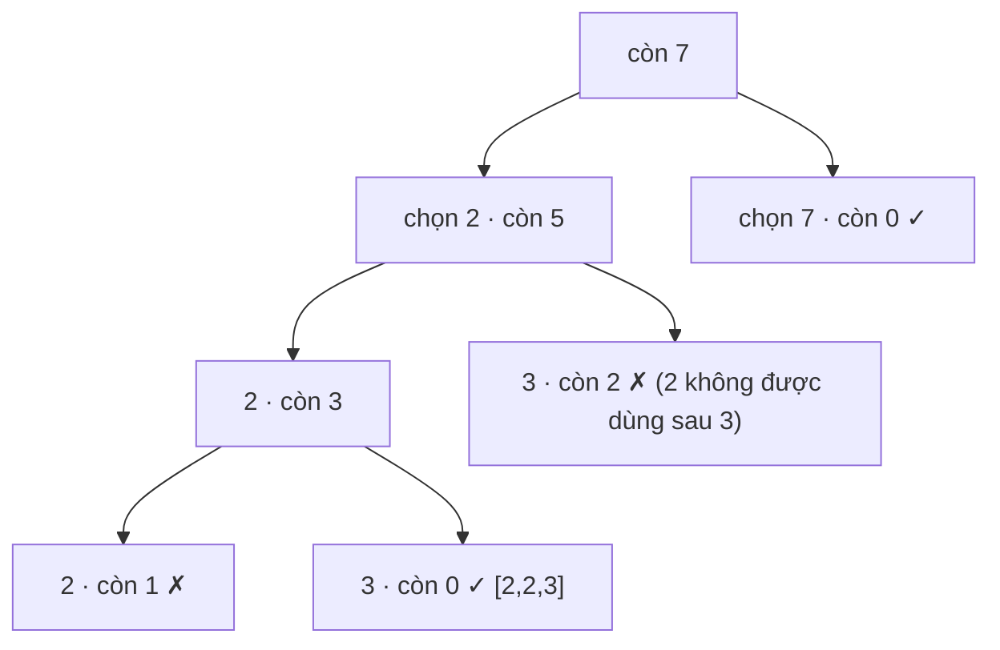

<!-- approaches: Backtracking with reuse · Sorted with pruning · DP by target -->
# 39. Combination Sum

**Medium** · Array · Backtracking · [LeetCode ↗](https://leetcode.com/problems/combination-sum/) · Code: [CombinationSum.java](CombinationSum.java) · Tests: [CombinationSumTest.java](CombinationSumTest.java)

## Đề bài

Các số dương **khác nhau** và một `target`. Liệt kê mọi tổ hợp có tổng bằng `target`; **mỗi số dùng bao nhiêu lần cũng được**.

```
[2,3,6,7], target = 7 -> [[2,2,3], [7]]
```

## Ý tưởng

> Backtracking, nhưng sau khi chọn `c[i]` thì lần sau vẫn được chọn lại **chính `c[i]`** (dùng lại) — chỉ không được quay về số **đứng trước** nó. Nhờ vậy mỗi tổ hợp chỉ sinh ra **một lần**, theo thứ tự không giảm.



## Cách 1 — Backtracking + cắt tỉa ⭐

So với Subsets, chỉ khác một chỗ: gọi đệ quy với `i` thay vì `i + 1`.
Sắp xếp trước để `break` ngay khi `c[i] > còn lại` — mọi số sau còn lớn hơn.

## Cách 2 — DP theo target (như đổi tiền)

`combos[t]` = các tổ hợp có tổng `t`. Duyệt **ứng viên ở vòng ngoài**, target ở vòng trong → mỗi tổ hợp chỉ được dựng theo một thứ tự (giống bài 518 Coin Change II đếm tổ hợp chứ không đếm hoán vị). Tốn bộ nhớ hơn, nhưng cho thấy quan hệ với họ bài đổi tiền.

## So sánh với các bài cùng họ

| Bài | Dùng lại? | Có trùng? | Đệ quy với |
|---|---|---|---|
| 39 (bài này) | có | không | `i` |
| 40 Combination Sum II | không | có | `i + 1`, bỏ qua trùng |
| 216 Combination Sum III | không | không, chỉ 1..9 | `i + 1`, đúng `k` số |

## Bài liên quan

40 Combination Sum II · 216 Combination Sum III · 377 Combination Sum IV (đếm hoán vị — DP) · 518 Coin Change II.
