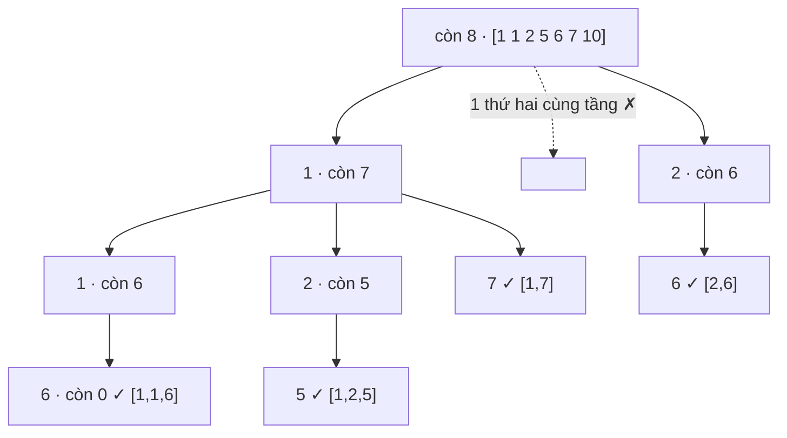

<!-- approaches: Backtracking with sorting and skip rule · Count map -->
# 40. Combination Sum II

**Medium** · Array · Backtracking · [LeetCode ↗](https://leetcode.com/problems/combination-sum-ii/) · Code: [CombinationSumII.java](CombinationSumII.java) · Tests: [CombinationSumIITest.java](CombinationSumIITest.java)

## Đề bài

Các số (có thể **trùng**), mỗi số dùng **tối đa một lần**. Liệt kê mọi tổ hợp **không trùng** có tổng bằng `target`.

```
[10,1,2,7,6,1,5], target = 8 -> [1,1,6] [1,2,5] [1,7] [2,6]
```

## Ý tưởng

> Kết hợp hai quy tắc đã gặp:
> - **Không dùng lại**: đệ quy với `i + 1` (như Subsets, khác 39 Combination Sum).
> - **Không trùng tổ hợp**: sắp xếp, và ở **cùng một tầng** bỏ qua giá trị giống giá trị vừa thử (như 90 Subsets II).



## Cách 1 — Sắp xếp + backtracking + bỏ qua cùng tầng ⭐

Thêm cắt tỉa `c[i] <= remaining` (mảng đã sắp xếp nên `break` được).

## Cách 2 — Theo bảng đếm

Gom các giá trị khác nhau kèm số lượng; với mỗi giá trị, quyết định lấy **0, 1, 2, … bản**. Không thể sinh trùng vì mỗi giá trị chỉ được xét ở đúng một tầng.

## So sánh họ Combination Sum

| | 39 | 40 (bài này) | 216 |
|---|---|---|---|
| Có trùng trong input | không | **có** | không |
| Dùng lại | có | **không** | không |
| Đệ quy với | `i` | `i + 1` + bỏ qua trùng | `i + 1` |

## Bài liên quan

39 Combination Sum · 90 Subsets II · 216 Combination Sum III · 47 Permutations II.
