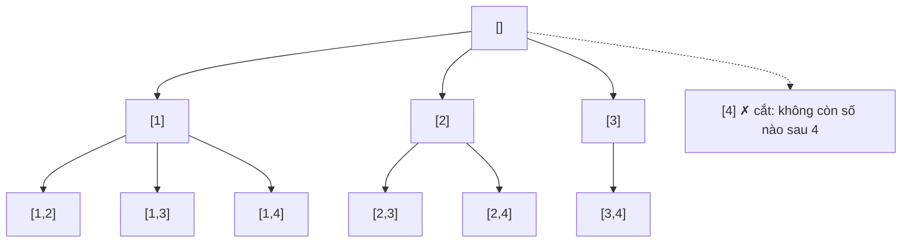

<!-- approaches: Backtracking · Backtracking with pruning · Iterative (lexicographic) -->
# 77. Combinations

**Medium** · Backtracking · [LeetCode ↗](https://leetcode.com/problems/combinations/) · Code: [Combinations.java](Combinations.java) · Tests: [CombinationsTest.java](CombinationsTest.java)

## Đề bài

Liệt kê mọi tổ hợp chập `k` của các số `1 … n`.

```
n = 4, k = 2 -> [1,2] [1,3] [1,4] [2,3] [2,4] [3,4]
```

## Ý tưởng

> Như Subsets, nhưng chỉ ghi nhận khi đủ **đúng k** phần tử. Thêm **cắt tỉa**: nếu số còn lại không đủ để lấp đầy tổ hợp thì không cần thử.



## Cách 1 — Backtracking + cắt tỉa ⭐

Còn cần `need = k − path.size()` số, nên số bắt đầu `i` không được vượt `n − need + 1`. Với `n = 20, k = 18` cắt tỉa giảm số lời gọi đi hàng trăm lần.

## Cách 2 — Sinh theo thứ tự từ điển (lặp)

Từ tổ hợp hiện tại, tìm vị trí **phải nhất** còn tăng được (`c[i] < n − k + 1 + i`), tăng nó lên 1 và đặt các vị trí sau thành dãy liên tiếp.

| hiện tại | vị trí tăng | kế tiếp |
|---|---|---|
| 1 2 | 1 (2 → 3) | 1 3 |
| 1 4 | 0 (1 → 2) | 2 3 |
| 3 4 | không còn | dừng |

## Độ phức tạp

`O(k · C(n, k))`.

## Bài liên quan

78 Subsets · 39 Combination Sum · 216 Combination Sum III · 46 Permutations.
