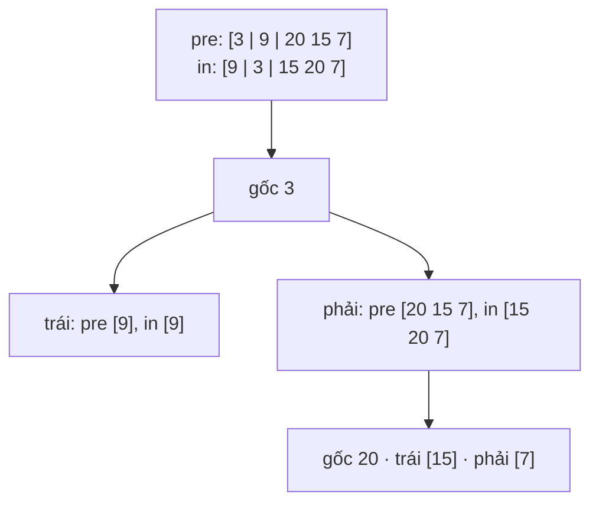

<!-- approaches: Recursion with index map · Iterative with a stack -->
# 105. Construct Binary Tree from Preorder and Inorder Traversal

**Medium** · Array · Hash Table · Divide and Conquer · Tree · [LeetCode ↗](https://leetcode.com/problems/construct-binary-tree-from-preorder-and-inorder-traversal/) · Code: [ConstructBinaryTreeFromPreorderAndInorderTraversal.java](ConstructBinaryTreeFromPreorderAndInorderTraversal.java) · Tests: [ConstructBinaryTreeFromPreorderAndInorderTraversalTest.java](ConstructBinaryTreeFromPreorderAndInorderTraversalTest.java)

## Đề bài

Dựng lại cây nhị phân từ dãy **preorder** và **inorder** (các giá trị khác nhau).

```
preorder = [3, 9, 20, 15, 7]
inorder  = [9, 3, 15, 20, 7]        ->      3
                                           / \
                                          9  20
                                            /  \
                                           15   7
```

## Ý tưởng

> - Phần tử **đầu** của preorder luôn là **gốc**.
> - Trong inorder, mọi thứ **bên trái** gốc thuộc cây con trái, **bên phải** thuộc cây con phải.
> Biết kích thước cây con trái → cắt được preorder tương ứng → đệ quy.



## Cách 1 — Đệ quy + bảng vị trí `O(n)` ⭐

- `HashMap` giá trị → chỉ số trong inorder: tìm vị trí gốc `O(1)` thay vì quét `O(n)` (nếu không sẽ thành `O(n²)`).
- Không cần cắt mảng preorder: các gốc được "phát" **lần lượt** theo đúng thứ tự preorder, miễn là dựng **cây trái trước** cây phải. Chỉ cần một con trỏ `next` chạy dọc preorder.

## Cách 2 — Lặp với stack

Đi dọc preorder, cứ gắn làm **con trái** của đỉnh stack. Khi đỉnh stack trùng với phần tử inorder kế tiếp, nghĩa là cây con trái của nó đã xong → pop liên tục khi còn trùng; node cuối cùng bị pop nhận phần tử preorder tiếp theo làm **con phải**. Khó nghĩ ra hơn, nhưng không đệ quy.

## Bẫy & lưu ý

- Cần giá trị **khác nhau**; có trùng thì không xác định được vị trí gốc.
- Chỉ preorder + postorder thì **không** dựng lại được cây duy nhất (trừ khi cây đầy đủ — bài 889).

## Bài liên quan

106 Construct from Inorder and Postorder · 889 from Preorder and Postorder · 1008 BST from Preorder · 297 Serialize and Deserialize Binary Tree.
