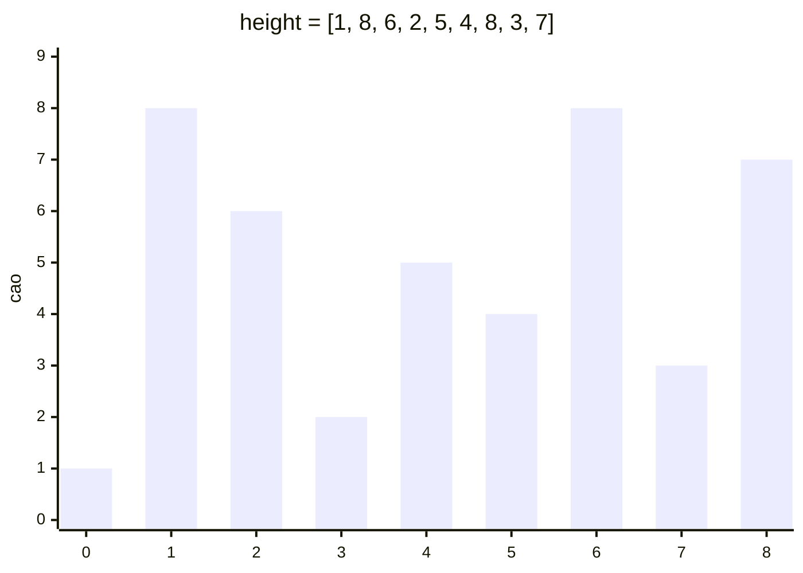

<!-- approaches: Brute force · Two pointers moving the shorter wall -->
# 11. Container With Most Water

**Medium** · Array · Two Pointers · Greedy · [LeetCode ↗](https://leetcode.com/problems/container-with-most-water/) · Code: [ContainerWithMostWater.java](ContainerWithMostWater.java) · Tests: [ContainerWithMostWaterTest.java](ContainerWithMostWaterTest.java)

## Đề bài

`height[i]` là chiều cao vạch tại `x = i`. Chọn hai vạch cùng trục hoành tạo thành bể chứa **nhiều nước nhất**.

```
[1,8,6,2,5,4,8,3,7] -> 49     vạch 1 (cao 8) và vạch 8 (cao 7): min(8,7) × 7 = 49
```

## Ý tưởng

> Diện tích = `min(trái, phải) × khoảng cách`. Bắt đầu với hai vạch **xa nhất**. Mỗi bước, dời vạch **thấp hơn** vào trong.
> **Vì sao an toàn?** Giữ vạch thấp và dời vạch kia vào: chiều rộng giảm, mực nước vẫn bị vạch thấp chặn ở mức cũ (hoặc thấp hơn) → **không bao giờ tốt hơn**. Vậy vạch thấp có thể bị loại vĩnh viễn.



| lo | hi | min × rộng | best | dời |
|---|---|---|---|---|
| 0 (1) | 8 (7) | 1 × 8 = 8 | 8 | lo |
| 1 (8) | 8 (7) | 7 × 7 = 49 | **49** | hi |
| 1 (8) | 7 (3) | 3 × 6 = 18 | 49 | hi |
| 1 (8) | 6 (8) | 8 × 5 = 40 | 49 | hi (bằng nhau, dời bên nào cũng được) |
| … | | | 49 | |

## Cách 1 — Vét cạn `O(n²)`

## Cách 2 — Hai con trỏ `O(n)` ⭐

Lập luận "loại bỏ" ở trên là phần người phỏng vấn muốn nghe nhất.

## So với 42 Trapping Rain Water

| | 11 (bài này) | 42 |
|---|---|---|
| Hình dạng | chỉ 2 vạch làm thành, bỏ qua các vạch giữa | mọi vạch đều chiếm chỗ |
| Hỏi | bể lớn nhất | tổng nước đọng |

## Bài liên quan

42 Trapping Rain Water (Hard) · 167 Two Sum II · 15 3Sum.
