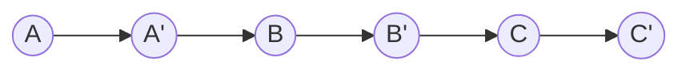

<!-- approaches: Hash map old -> new · Interleave copies (O(1) space) -->
# 138. Copy List with Random Pointer

**Medium** · Hash Table · Linked List · [LeetCode ↗](https://leetcode.com/problems/copy-list-with-random-pointer/) · Code: [CopyListWithRandomPointer.java](CopyListWithRandomPointer.java) · Tests: [CopyListWithRandomPointerTest.java](CopyListWithRandomPointerTest.java)

## Đề bài

Mỗi node có `next` và `random` (trỏ tới node bất kỳ hoặc `null`). Tạo **bản sao sâu** của danh sách.

```
7 → 13 → 11 → 10 → 1
     ↓random: 13→7, 11→1, 10→11, 1→7
```

## Ý tưởng

> Khó khăn: khi sao chép node `A`, `A.random` có thể trỏ tới node **chưa được sao chép**. Cần một cách tra "**bản sao của node X là gì**".

## Cách 1 — HashMap gốc → bản sao `O(n)` bộ nhớ ⭐ (dễ nghĩ)

Lượt 1 tạo mọi bản sao vào map. Lượt 2 nối: `copy(p).next = copy(p.next)`, `copy(p).random = copy(p.random)`.

## Cách 2 — Đan bản sao vào danh sách gốc `O(1)` bộ nhớ

Đặt mỗi bản sao **ngay sau** node gốc — vị trí đó thay cho HashMap: bản sao của `X` chính là `X.next`.



1. **Đan**: `A → A' → B → B' → …`
2. **Nối random**: `A'.random = A.random.next` (bản sao của node mà `A.random` trỏ tới).
3. **Tách**: lấy các node ở vị trí chẵn thành danh sách mới, **khôi phục** danh sách gốc.

## Bẫy & lưu ý

- `random` có thể là `null` — kiểm tra trước khi `.next`.
- Phải khôi phục danh sách gốc ở bước 3 (test kiểm tra).

## Bài liên quan

133 Clone Graph · 1485 Clone Binary Tree With Random Pointer · 146 LRU Cache.
