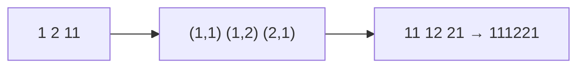

<!-- approaches: Iterative run-length encoding · Recursive -->
# 38. Count and Say

**Medium** · String · [LeetCode ↗](https://leetcode.com/problems/count-and-say/) · Code: [CountAndSay.java](CountAndSay.java) · Tests: [CountAndSayTest.java](CountAndSayTest.java)

## Đề bài

Dãy "đếm và đọc": số hạng sau là cách **đọc to** số hạng trước.

```
1         -> "một số 1"            -> 11
11        -> "hai số 1"            -> 21
21        -> "một số 2, một số 1"  -> 1211
1211      -> "một 1, một 2, hai 1" -> 111221
```

## Ý tưởng

> Mỗi bước là **mã hoá độ dài loạt** (run-length encoding): gom các chữ số giống nhau liên tiếp thành cặp `(số lượng, chữ số)`.



## Cách 1 — Lặp ⭐

Hai con trỏ `i`, `j`: `j` chạy tới hết loạt chữ số giống `s[i]`, ghi `j − i` rồi `s[i]`.

## Cách 2 — Đệ quy

Viết thẳng định nghĩa.

## Ghi chú

- Dãy chỉ gồm chữ số 1, 2, 3 (không bao giờ có 4 chữ số giống nhau liên tiếp).
- Độ dài tăng khoảng 30% mỗi bước (hằng số Conway ≈ 1.3036) — `n = 30` đã dài ~4400 ký tự.

## Bài liên quan

443 String Compression (cùng kỹ thuật gom loạt) · 1531 String Compression II (Hard).
