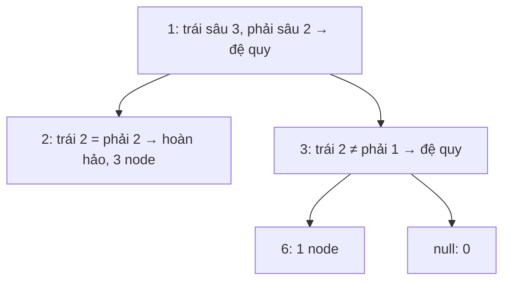

<!-- approaches: Count every node · Compare left/right heights · Binary search on the last level -->
# 222. Count Complete Tree Nodes

**Medium** · Binary Search · Bit Manipulation · Tree · Binary Tree · [LeetCode ↗](https://leetcode.com/problems/count-complete-tree-nodes/) · Code: [CountCompleteTreeNodes.java](CountCompleteTreeNodes.java) · Tests: [CountCompleteTreeNodesTest.java](CountCompleteTreeNodesTest.java)

## Đề bài

Đếm số node của **cây nhị phân đầy đủ** (complete: mọi tầng đều đầy, trừ tầng cuối được lấp từ trái sang). Yêu cầu nhanh hơn `O(n)`.

```
      1
     / \
    2   3       -> 6
   / \  /
  4  5 6
```

## Ý tưởng

> Cây **hoàn hảo** (perfect) cao `h` có đúng `2ʰ − 1` node — không cần đếm.
> Đo độ sâu theo nhánh **trái nhất** và **phải nhất**: bằng nhau → hoàn hảo, trả công thức. Khác nhau → đệ quy hai cây con, và **ít nhất một** trong hai luôn hoàn hảo (trả về ngay).



## Cách 1 — Đếm thường `O(n)`

## Cách 2 — So độ sâu trái/phải `O(log² n)` ⭐

Mỗi tầng đệ quy chỉ đi sâu vào **một** nhánh; mỗi lần đo độ sâu tốn `O(log n)` → tổng `O(log n · log n)`.

## Cách 3 — Tìm kiếm nhị phân trên tầng cuối

Tầng cuối có các vị trí `0 … 2ᵈ − 1`. Các node có mặt luôn là một **tiền tố** (lấp từ trái) → tìm kiếm nhị phân vị trí cuối cùng tồn tại. Kiểm tra vị trí `idx`: đọc các bit của `idx` từ cao xuống thấp, `0` đi trái, `1` đi phải.

```
d = 2, idx = 2 = 10₂: gốc → phải (1) → trái (0)
```

## Bài liên quan

958 Check Completeness of a Binary Tree · 104 Maximum Depth · 919 Complete Binary Tree Inserter.
