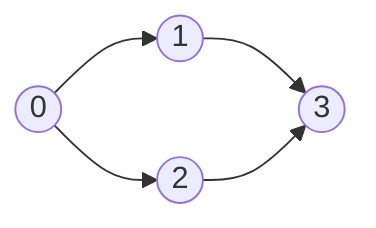

<!-- approaches: Kahn's topological sort (BFS) · DFS three-color cycle detection -->
# 207. Course Schedule

**Medium** · Depth-First Search · Breadth-First Search · Graph Theory · Topological Sort · [LeetCode ↗](https://leetcode.com/problems/course-schedule/) · Code: [CourseSchedule.java](CourseSchedule.java) · Tests: [CourseScheduleTest.java](CourseScheduleTest.java)

## Đề bài

Có `numCourses` môn. `[a, b]` nghĩa là phải học `b` trước `a`. Có học hết được không?

```
2, [[1,0]]        -> true    (0 rồi 1)
2, [[1,0],[0,1]]  -> false   (0 cần 1, 1 cần 0)
```

## Ý tưởng

> Vẽ đồ thị có hướng `b → a`. Học hết được ⇔ đồ thị **không có chu trình** ⇔ tồn tại **thứ tự topo**.



**Kahn (BFS):** môn nào không còn môn tiên quyết (bậc vào = 0) thì học được ngay. Học xong thì giảm bậc vào của các môn phụ thuộc. Nếu cuối cùng học được đủ `numCourses` môn → không có chu trình; các môn nằm trong chu trình không bao giờ về bậc 0.

| bước | hàng đợi | học |
|---|---|---|
| 1 | [0] | 0 → bậc vào của 1, 2 về 0 |
| 2 | [1, 2] | 1, 2 → bậc vào của 3 về 0 |
| 3 | [3] | 3 → đủ 4 môn ✓ |

## Cách 1 — Kahn `O(V + E)` ⭐

## Cách 2 — DFS ba màu

Trắng = chưa thăm, **xám = đang trên đường đi hiện tại**, đen = xong. Gặp lại node xám → có cạnh quay ngược → chu trình.

## Bài liên quan

210 Course Schedule II (in ra thứ tự) · 269 Alien Dictionary · 1203 Sort Items by Groups · 802 Find Eventual Safe States.
