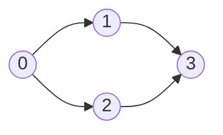

<!-- approaches: Kahn's algorithm (BFS on in-degrees) · DFS postorder with cycle detection -->
# 210. Course Schedule II

**Medium** · Depth-First Search · Breadth-First Search · Graph Theory · Topological Sort · [LeetCode ↗](https://leetcode.com/problems/course-schedule-ii/) · Code: [CourseScheduleII.java](CourseScheduleII.java) · Tests: [CourseScheduleIITest.java](CourseScheduleIITest.java)

## Đề bài

`numCourses` môn học; `[a, b]` nghĩa là phải học `b` **trước** `a`. Trả về một thứ tự học hết các môn, hoặc mảng rỗng nếu không thể (có vòng phụ thuộc).

```
4, [[1,0],[2,0],[3,1],[3,2]] -> [0,1,2,3]  (hoặc [0,2,1,3])
```

## Ý tưởng

> Đây là **sắp xếp tô-pô** (topological sort) trên đồ thị có hướng `b → a`. Chỉ tồn tại khi đồ thị **không có chu trình** (DAG).



## Cách 1 — Thuật toán Kahn (BFS theo bậc vào) ⭐

1. Đếm **bậc vào** (số môn tiên quyết còn thiếu) của mỗi môn.
2. Đưa mọi môn có bậc vào 0 vào hàng đợi.
3. Lấy một môn ra, thêm vào thứ tự; giảm bậc vào của các môn phụ thuộc nó — môn nào về 0 thì vào hàng đợi.
4. Không lấy được đủ `n` môn → còn môn kẹt trong **chu trình**.

| lấy ra | bậc vào sau (1, 2, 3) | hàng đợi |
|---|---|---|
| (đầu) | 1, 1, 2 | 0 |
| 0 | 0, 0, 2 | 1, 2 |
| 1 | –, 0, 1 | 2 |
| 2 | –, –, 0 | 3 |
| 3 | | → [0, 1, 2, 3] |

## Cách 2 — DFS hậu thứ tự (postorder)

Một môn "xong" khi mọi môn phụ thuộc nó đã xong → **đảo ngược thứ tự hoàn thành** là một lịch hợp lệ. Ba trạng thái: chưa thăm / đang thăm / xong. Gặp lại node **đang thăm** = cạnh ngược = chu trình.

## Bài liên quan

207 Course Schedule (chỉ hỏi có được không) · 269 Alien Dictionary (Hard) · 1136 Parallel Courses · 2050 Parallel Courses III (Hard).
