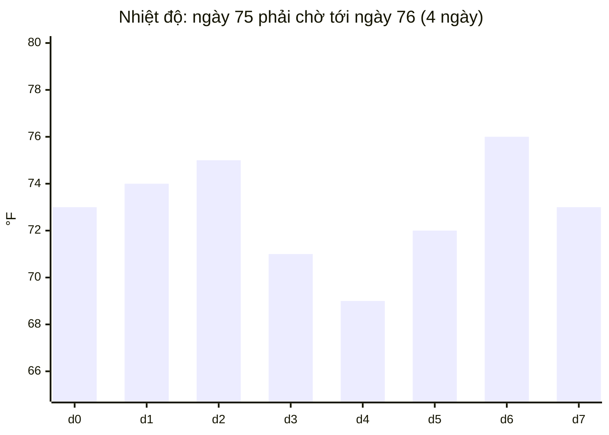

<!-- approaches: Brute force · Monotonic stack · Backward jumps -->
# 739. Daily Temperatures

**Medium** · Array · Stack · Monotonic Stack · [LeetCode ↗](https://leetcode.com/problems/daily-temperatures/) · Code: [DailyTemperatures.java](DailyTemperatures.java) · Tests: [DailyTemperaturesTest.java](DailyTemperaturesTest.java)

## Đề bài

Với mỗi ngày, phải chờ **bao nhiêu ngày** mới có ngày **ấm hơn**? Không có → 0.

```
[73,74,75,71,69,72,76,73] -> [1,1,4,2,1,1,0,0]
```

## Ý tưởng

> **Stack đơn điệu** (như 496 Next Greater Element): stack giữ **chỉ số** các ngày đang chờ, nhiệt độ **giảm dần** từ đáy lên đỉnh. Ngày mới ấm hơn đỉnh → "giải quyết" đỉnh: khoảng chờ = `i − j`.



| i | t[i] | pop (ghi đáp án) | stack sau (nhiệt độ) |
|---|---|---|---|
| 0 | 73 | | 73 |
| 1 | 74 | d0 = 1 | 74 |
| 2 | 75 | d1 = 1 | 75 |
| 3 | 71 | | 75 71 |
| 4 | 69 | | 75 71 69 |
| 5 | 72 | d4 = 1, d3 = 2 | 75 72 |
| 6 | 76 | d5 = 1, d2 = 4 | 76 |
| 7 | 73 | | 76 73 → còn lại = 0 |

## Cách 1 — Vét cạn `O(n²)`

## Cách 2 — Stack đơn điệu `O(n)` ⭐

Lưu **chỉ số** (không phải nhiệt độ) để tính được khoảng cách.

## Cách 3 — Nhảy ngược từ phải, không stack

Đi từ phải sang. Để tìm ngày ấm hơn của ngày `i`, bắt đầu ở `j = i + 1`: nếu ngày `j` không ấm hơn thì **nhảy** thẳng tới ngày ấm hơn của chính `j` (`j += out[j]`) — mọi ngày ở giữa đều lạnh hơn `t[j]` nên cũng không ấm hơn `t[i]`. Giữ thêm `hottest` để biết ngay khi không có đáp án.

## Bài liên quan

496 Next Greater Element I · 503 Next Greater Element II · 901 Online Stock Span · 84 Largest Rectangle in Histogram.
