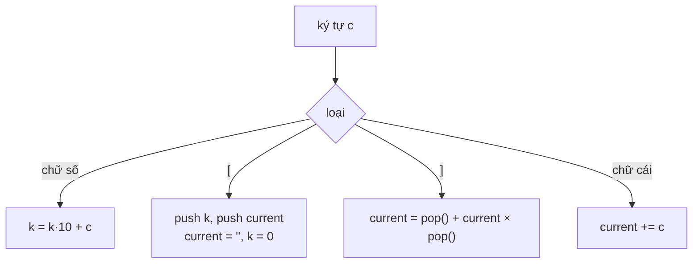

<!-- approaches: Two stacks · Recursive descent -->
# 394. Decode String

**Medium** · String · Stack · Recursion · [LeetCode ↗](https://leetcode.com/problems/decode-string/) · Code: [DecodeString.java](DecodeString.java) · Tests: [DecodeStringTest.java](DecodeStringTest.java)

## Đề bài

Giải mã chuỗi dạng `k[nội dung]` (lặp `nội dung` `k` lần), có thể **lồng nhau**.

```
"3[a2[c]]"      -> "accaccacc"
"2[abc]3[cd]ef" -> "abcabccdcdcdef"
```

## Ý tưởng

> Ngoặc lồng nhau → **stack**. Gặp `[`: cất "phần đã giải mã bên ngoài" và "số lần lặp" vào stack, bắt đầu một chuỗi mới cho bên trong. Gặp `]`: lấy ra, nối `bên ngoài + bên trong × k`.

`"3[a2[c]]"`:

| ký tự | counts | outer | current |
|---|---|---|---|
| 3 | | | (k = 3) |
| [ | 3 | "" | "" |
| a | 3 | "" | a |
| 2 | | | (k = 2) |
| [ | 3 2 | "" "a" | "" |
| c | | | c |
| ] | 3 | "" | a + cc = acc |
| ] | | | "" + acc×3 = accaccacc |



## Cách 1 — Hai stack ⭐

## Cách 2 — Đệ quy (recursive descent)

Hàm `parse` đọc tới khi gặp `]` hoặc hết chuỗi; gặp số thì đọc số, bỏ `[`, gọi đệ quy cho phần bên trong, bỏ `]`. Stack của hệ thống thay cho stack tự quản. Đây là cách viết parser cho biểu thức (224, 227, 726).

## Bẫy & lưu ý

- Số có thể có **nhiều chữ số** (`12[a]`).
- Có chữ cái **ngoài** mọi ngoặc (`…ef`).

## Bài liên quan

224 Basic Calculator (Hard) · 726 Number of Atoms (Hard) · 20 Valid Parentheses · 1106 Parsing A Boolean Expression.
