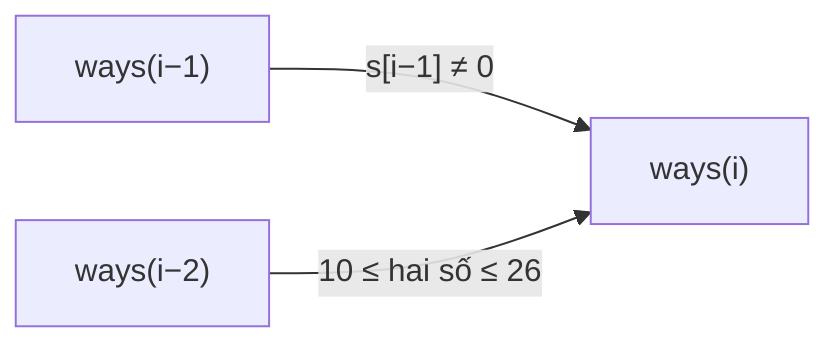

<!-- approaches: DP over prefixes with two rolling variables -->
# 91. Decode Ways

**Medium** · String · Dynamic Programming · [LeetCode ↗](https://leetcode.com/problems/decode-ways/) · Code: [DecodeWays.java](DecodeWays.java) · Tests: [DecodeWaysTest.java](DecodeWaysTest.java)

## Đề bài

Chữ cái mã hoá thành `"1"…"26"`. Một chuỗi số có bao nhiêu cách giải mã? (`"06"` không hợp lệ.)

```
"226" -> 3   (2 2 6 = BBF, 22 6 = VF, 2 26 = BZ)
```

## Ý tưởng

> Nhìn **mảnh cuối cùng**: là **một chữ số** (hợp lệ nếu khác `0`) hoặc **hai chữ số** (hợp lệ nếu trong `10…26`).
> `ways(i) = [s[i−1] ≠ '0'] · ways(i−1) + [10 ≤ s[i−2..i) ≤ 26] · ways(i−2)` — giống Fibonacci có điều kiện.

`"226"`:

| i | tiền tố | 1 chữ số | 2 chữ số | ways |
|---|---|---|---|---|
| 0 | "" | | | 1 |
| 1 | "2" | 2 ✓ | | 1 |
| 2 | "22" | 2 ✓ → 1 | 22 ✓ → 1 | 2 |
| 3 | "226" | 6 ✓ → 2 | 26 ✓ → 1 | **3** |



## Lời giải `O(n) · O(1)` ⭐

Bẫy về số 0: `"10"` → 1 cách, `"100"` → 0 cách (số `0` cuối không đứng một mình được, `"00"` cũng không), `"06"` → 0.

## Bài liên quan

639 Decode Ways II (có `*`, Hard) · 70 Climbing Stairs · 1416 Restore The Array · 2266 Count Number of Texts.
