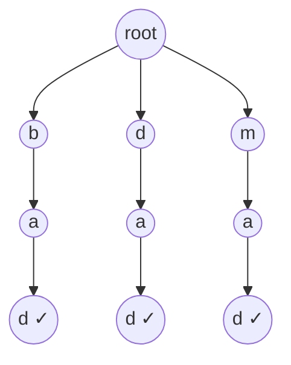

<!-- approaches: Trie + DFS for '.' wildcards -->
# 211. Design Add and Search Words Data Structure

**Medium** · String · Depth-First Search · Design · Trie · [LeetCode ↗](https://leetcode.com/problems/design-add-and-search-words-data-structure/) · Code: [DesignAddAndSearchWordsDataStructure.java](DesignAddAndSearchWordsDataStructure.java) · Tests: [DesignAddAndSearchWordsDataStructureTest.java](DesignAddAndSearchWordsDataStructureTest.java)

## Đề bài

Thiết kế `WordDictionary`: `addWord(word)` và `search(word)`, trong đó `.` khớp với **một chữ cái bất kỳ**.

```
add bad, dad, mad
search "pad" -> false    ".ad" -> true    "b.." -> true
```

## Ý tưởng

> Lưu từ trong **Trie** (bài 208). Tìm kiếm đi theo từng chữ; gặp `.` thì **rẽ nhánh** vào tất cả con hiện có (DFS), chỉ cần một nhánh thành công.



`".ad"`: ở gốc gặp `.` → thử cả `b`, `d`, `m`; nhánh `b → a → d` kết thúc ở node đánh dấu từ ✓.

## Lời giải — Trie + DFS ⭐

| thao tác | thời gian |
|---|---|
| `addWord` | `O(L)` |
| `search` không có `.` | `O(L)` |
| `search` có `k` dấu `.` | tệ nhất `O(26ᵏ · L)` |

**Bẫy:** phải kiểm tra cờ `end` ở node cuối — `"b."` đi được tới node `ba` nhưng `ba` không phải một từ.

## Bài liên quan

208 Implement Trie · 212 Word Search II · 745 Prefix and Suffix Search · 676 Implement Magic Dictionary.
