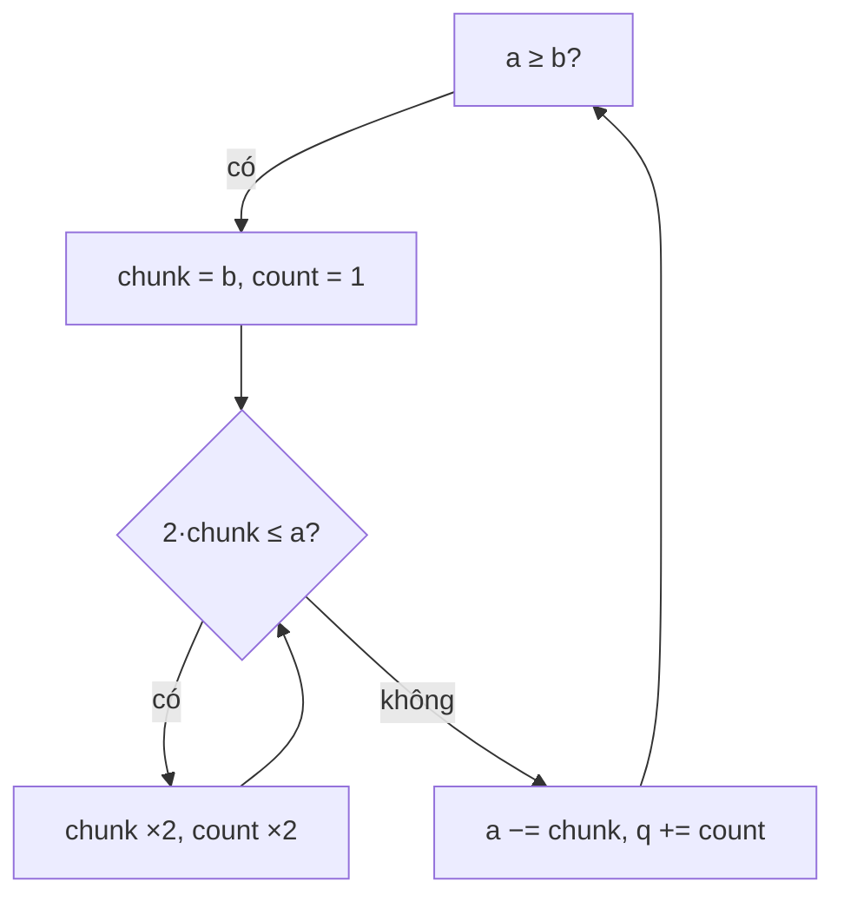

<!-- approaches: Doubling subtraction on negatives · Bit shifts from high to low -->
# 29. Divide Two Integers

**Medium** · Math · Bit Manipulation · [LeetCode ↗](https://leetcode.com/problems/divide-two-integers/) · Code: [DivideTwoIntegers.java](DivideTwoIntegers.java) · Tests: [DivideTwoIntegersTest.java](DivideTwoIntegersTest.java)

## Đề bài

Chia hai số nguyên 32-bit **không dùng** `*`, `/`, `%`; làm tròn về 0. Tràn số thì trả `Integer.MAX_VALUE`.

```
(10, 3) -> 3     (7, −3) -> −2     (−2147483648, −1) -> 2147483647
```

## Ý tưởng — trừ theo cấp số nhân

> Trừ dần `divisor` là `O(n)` — với `2³¹ / 1` thì quá chậm. Thay vào đó **nhân đôi** số chia (`b, 2b, 4b, …`) tới khi còn nhỏ hơn số bị chia, trừ đi khối lớn nhất, cộng `2ᵏ` vào thương. Lặp với phần còn lại.

`10 / 3`:

| còn lại | khối lớn nhất | thương cộng thêm |
|---|---|---|
| 10 | 3 → 6 (6·2 = 12 &gt; 10) | 2 |
| 4 | 3 | 1 |
| 1 | — dừng | **3** |



## Cách 1 — Làm việc trên số âm ⭐

Miền số âm của `int` rộng hơn số dương (`−2³¹` không có số đối) → đổi **cả hai sang âm** thì không phải xử lý riêng `MIN_VALUE`. Trường hợp tràn duy nhất: `MIN_VALUE / −1`.

## Cách 2 — Dịch bit từ cao xuống thấp

Giống chia dài ở hệ nhị phân: với `k = 31 … 0`, nếu `(a >> k) ≥ b` thì trừ `b << k` và bật bit `k` của thương. Dùng `long` cho gọn.

## Bài liên quan

50 Pow(x, n) · 69 Sqrt(x) · 166 Fraction to Recurring Decimal · 371 Sum of Two Integers.
