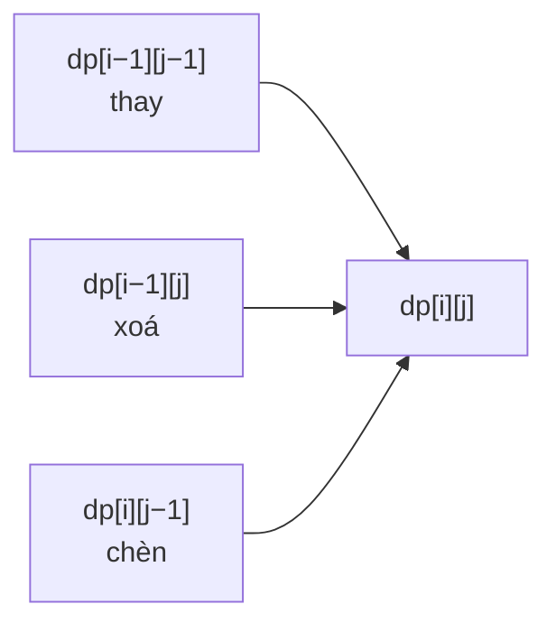

<!-- approaches: Memoized recursion · 2D DP · Two rolling rows -->
# 72. Edit Distance

**Medium** · String · Dynamic Programming · [LeetCode ↗](https://leetcode.com/problems/edit-distance/) · Code: [EditDistance.java](EditDistance.java) · Tests: [EditDistanceTest.java](EditDistanceTest.java)

## Đề bài

Số thao tác ít nhất (chèn, xoá, thay một ký tự) để biến `word1` thành `word2` — **khoảng cách Levenshtein**.

```
horse -> rorse (thay h→r) -> rose (xoá r) -> ros (xoá e)   = 3
```

## Ý tưởng

> `dp[i][j]` = khoảng cách giữa `i` ký tự đầu của `word1` và `j` ký tự đầu của `word2`. Nhìn **ký tự cuối**:
> - Giống nhau → không tốn gì: `dp[i−1][j−1]`.
> - Khác nhau → 1 + rẻ nhất trong ba thao tác:

| thao tác | về ô |
|---|---|
| thay `a[i−1]` bằng `b[j−1]` | `dp[i−1][j−1]` |
| xoá `a[i−1]` | `dp[i−1][j]` |
| chèn `b[j−1]` | `dp[i][j−1]` |



Bảng cho `horse` → `ros`:

| | "" | r | o | s |
|---|---|---|---|---|
| "" | 0 | 1 | 2 | 3 |
| h | 1 | 1 | 2 | 3 |
| o | 2 | 2 | 1 | 2 |
| r | 3 | 2 | 2 | 2 |
| s | 4 | 3 | 3 | 2 |
| e | 5 | 4 | 4 | **3** |

Hàng/cột đầu: biến chuỗi rỗng thành chuỗi dài `j` cần `j` lần chèn (và ngược lại).

## Cách 1 — Đệ quy có nhớ

## Cách 2 — Bảng 2D `O(m·n)` ⭐ (để giải thích)

## Cách 3 — Hai hàng `O(n)` bộ nhớ

## Ứng dụng

Kiểm tra chính tả ("có phải ý bạn là…"), so sánh chuỗi DNA, `diff`.

## Bài liên quan

1143 Longest Common Subsequence · 583 Delete Operation for Two Strings · 161 One Edit Distance · 10 Regular Expression Matching.
