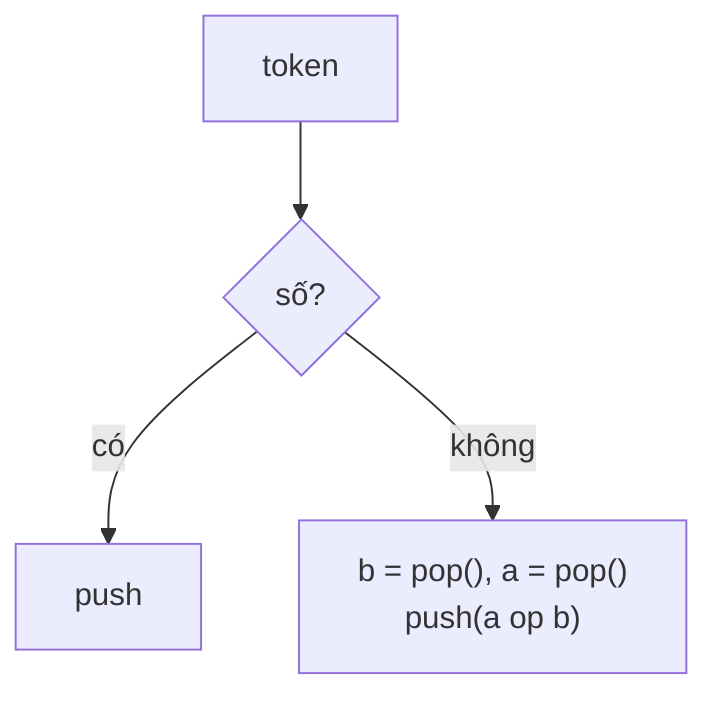

<!-- approaches: Stack · Recursion from the end -->
# 150. Evaluate Reverse Polish Notation

**Medium** · Array · Math · Stack · [LeetCode ↗](https://leetcode.com/problems/evaluate-reverse-polish-notation/) · Code: [EvaluateReversePolishNotation.java](EvaluateReversePolishNotation.java) · Tests: [EvaluateReversePolishNotationTest.java](EvaluateReversePolishNotationTest.java)

## Đề bài

Tính giá trị biểu thức viết theo **ký pháp Ba Lan ngược** (toán tử đứng **sau** hai toán hạng). Phép chia làm tròn về 0.

```
["2","1","+","3","*"]  =  (2 + 1) * 3  =  9
```

## Ý tưởng

> Đọc từ trái sang: gặp **số** thì đẩy vào stack; gặp **toán tử** thì lấy hai số trên cùng ra tính, đẩy kết quả lại. Không cần ngoặc, không cần thứ tự ưu tiên — đó là lý do máy tính và trình biên dịch thích ký pháp này.

| token | stack sau |
|---|---|
| 4 | 4 |
| 13 | 4 13 |
| 5 | 4 13 5 |
| / | 4 2  (13 / 5) |
| + | 6 |



## Cách 1 — Stack ⭐

**Thứ tự lấy ra:** phần tử lấy ra trước là toán hạng **phải**. Quan trọng với `−` và `/`.

## Cách 2 — Đệ quy từ cuối

Token cuối là **gốc** của cây biểu thức. Đọc ngược: sau toán tử là toán hạng phải (cả cây con), rồi tới toán hạng trái.

## Bẫy & lưu ý

- `"-11"` là **số âm**, không phải toán tử — kiểm tra độ dài token.
- Phép chia Java `/` trên `int` đã làm tròn về 0, đúng như đề yêu cầu.

## Bài liên quan

224 Basic Calculator (Hard) · 227 Basic Calculator II · 20 Valid Parentheses · 394 Decode String.
