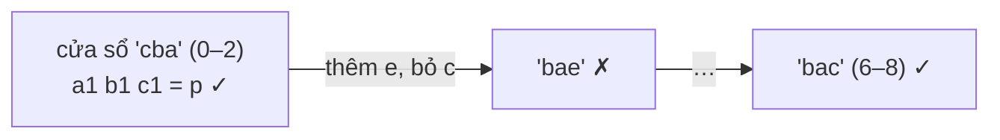

<!-- approaches: Sort every window · Sliding window with counts · Sliding window with a match counter -->
# 438. Find All Anagrams in a String

**Medium** · Hash Table · String · Sliding Window · [LeetCode ↗](https://leetcode.com/problems/find-all-anagrams-in-a-string/) · Code: [FindAllAnagramsInAString.java](FindAllAnagramsInAString.java) · Tests: [FindAllAnagramsInAStringTest.java](FindAllAnagramsInAStringTest.java)

## Đề bài

Tìm mọi vị trí bắt đầu của các **đảo chữ** (anagram) của `p` trong `s`.

```
s = "cbaebabacd", p = "abc" -> [0, 6]     ("cba", "bac")
```

## Ý tưởng

> Anagram của `p` = đoạn dài `|p|` có **cùng bảng đếm chữ cái**. Trượt một **cửa sổ cố định** dài `|p|` qua `s`: mỗi bước chỉ **thêm** một chữ vào và **bỏ** một chữ ra → cập nhật bảng đếm `O(1)`.



## Cách 1 — Sắp xếp từng cửa sổ `O(n · m log m)`

## Cách 2 — Cửa sổ trượt + so 26 ô ⭐

So hai mảng 26 phần tử mỗi bước: `O(26n)` = `O(n)`.

## Cách 3 — Đếm số chữ "cân bằng"

Giữ một mảng `diff = need − window` và biến `balanced` = số chữ có `diff = 0`. Thêm/bỏ một chữ chỉ làm thay đổi `balanced` của **chữ đó**. Cửa sổ là anagram ⇔ `balanced == 26`. Không cần quét 26 ô mỗi bước — hữu ích khi bảng chữ cái lớn.

## Bài liên quan

567 Permutation in String (chỉ hỏi có hay không) · 76 Minimum Window Substring (Hard, cửa sổ thay đổi kích thước) · 242 Valid Anagram · 49 Group Anagrams.
