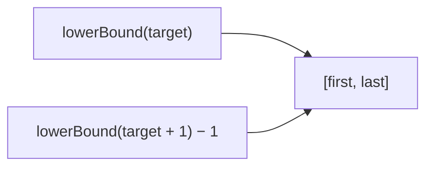

<!-- approaches: Two lower-bound binary searches -->
# 34. Find First and Last Position of Element in Sorted Array

**Medium** · Array · Binary Search · [LeetCode ↗](https://leetcode.com/problems/find-first-and-last-position-of-element-in-sorted-array/) · Code: [FindFirstAndLastPositionOfElementInSortedArray.java](FindFirstAndLastPositionOfElementInSortedArray.java) · Tests: [FindFirstAndLastPositionOfElementInSortedArrayTest.java](FindFirstAndLastPositionOfElementInSortedArrayTest.java)

## Đề bài

Mảng tăng dần. Trả về `[vị trí đầu, vị trí cuối]` của `target`, không có thì `[-1,-1]`. Yêu cầu `O(log n)`.

```
[5,7,7,8,8,10], 8 -> [3,4]
```

## Ý tưởng

> Một hàm **`lowerBound(x)`** = vị trí đầu tiên có giá trị `≥ x`. Dùng nó hai lần:
> - đầu = `lowerBound(target)`;
> - cuối = `lowerBound(target + 1) − 1`.

```
index:  0  1  2  3  4  5
nums:   5  7  7  8  8  10
                 ^        lowerBound(8) = 3
                       ^  lowerBound(9) = 5  → cuối = 4
```



## Lời giải `O(log n)` ⭐

Tìm một vị trí của `target` rồi loang ra hai bên là **sai yêu cầu**: mảng toàn số 8 sẽ thành `O(n)`.

**Bẫy:** `target + 1` tràn khi `target = Integer.MAX_VALUE` → truyền vào dạng `long`.

## Bài liên quan

35 Search Insert Position · 278 First Bad Version · 2089 Find Target Indices After Sorting Array · 704 Binary Search.
