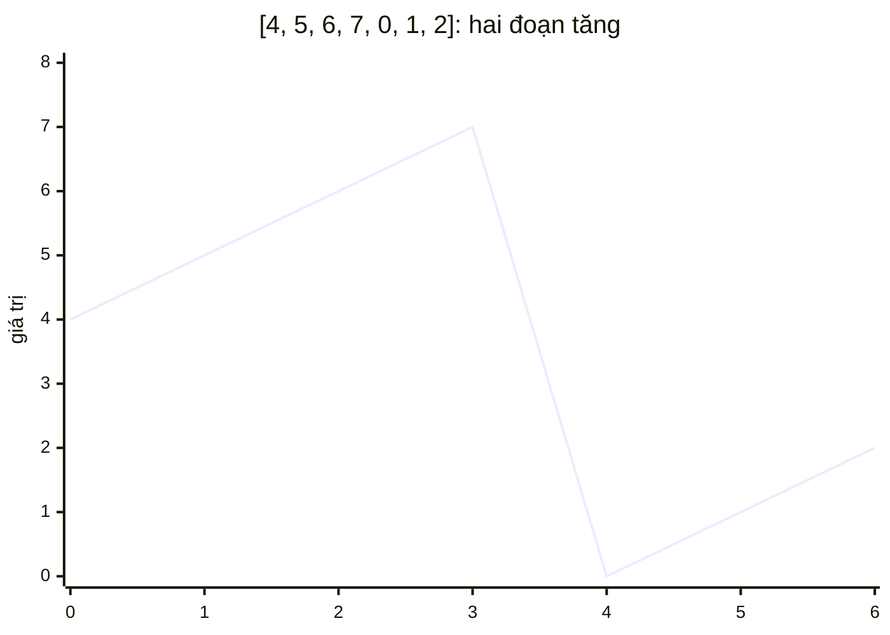

<!-- approaches: Linear scan · Binary search against the right end -->
# 153. Find Minimum in Rotated Sorted Array

**Medium** · Array · Binary Search · [LeetCode ↗](https://leetcode.com/problems/find-minimum-in-rotated-sorted-array/) · Code: [FindMinimumInRotatedSortedArray.java](FindMinimumInRotatedSortedArray.java) · Tests: [FindMinimumInRotatedSortedArrayTest.java](FindMinimumInRotatedSortedArrayTest.java)

## Đề bài

Mảng tăng dần (giá trị khác nhau) bị **xoay** một số lần. Tìm phần tử nhỏ nhất trong `O(log n)`.

```
[4,5,6,7,0,1,2] -> 0
```

## Ý tưởng

> Mảng xoay gồm **hai đoạn tăng**; điểm nhỏ nhất là chỗ "gãy". So `nums[mid]` với phần tử **cuối** `nums[hi]`:
> - `nums[mid] > nums[hi]` → `mid` thuộc đoạn **cao** bên trái → điểm gãy ở **bên phải** `mid`.
> - ngược lại → `mid … hi` đã tăng dần → nhỏ nhất ở `mid` hoặc **bên trái**.



| lo | hi | mid | nums[mid] vs nums[hi] | |
|---|---|---|---|---|
| 0 | 6 | 3 | 7 > 2 | lo = 4 |
| 4 | 6 | 5 | 1 < 2 | hi = 5 |
| 4 | 5 | 4 | 0 < 1 | hi = 4 → **0** |

## Cách 1 — Duyệt tuyến tính `O(n)`

## Cách 2 — Tìm kiếm nhị phân so với phần tử cuối `O(log n)` ⭐

**Vì sao so với `hi` mà không so với `lo`?** Nếu mảng **không xoay**, `nums[mid] > nums[lo]` cũng đúng, nhưng nhỏ nhất lại ở bên trái — so với `lo` không phân biệt được hai trường hợp; so với `hi` thì luôn đúng.

## Bài liên quan

154 Find Minimum II (có trùng — Hard) · 33 Search in Rotated Sorted Array · 162 Find Peak Element · 852 Peak Index in a Mountain Array.
