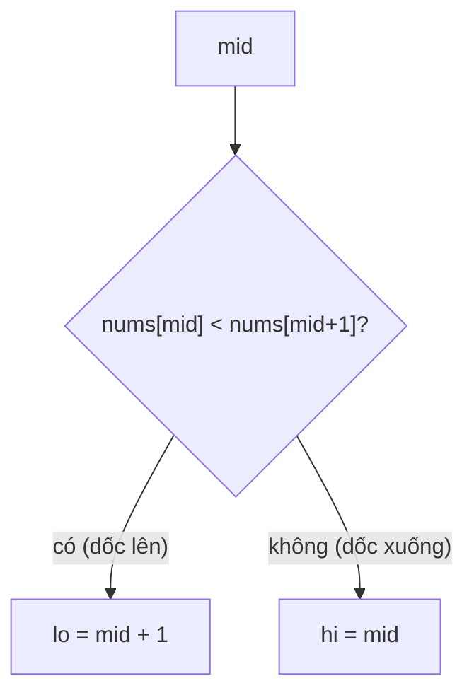

<!-- approaches: Binary search toward the rising side · Linear scan -->
# 162. Find Peak Element

**Medium** · Array · Binary Search · [LeetCode ↗](https://leetcode.com/problems/find-peak-element/) · Code: [FindPeakElement.java](FindPeakElement.java) · Tests: [FindPeakElementTest.java](FindPeakElementTest.java)

## Đề bài

**Đỉnh** là phần tử lớn hơn hẳn hai hàng xóm (coi `nums[−1] = nums[n] = −∞`, hai phần tử kề nhau luôn khác nhau). Trả về vị trí **một** đỉnh bất kỳ trong `O(log n)`.

```
[1,2,1,3,5,6,4] -> 1 hoặc 5
```

## Ý tưởng

> Mảng không sắp xếp nhưng vẫn **tìm nhị phân** được: nhìn cặp `nums[mid], nums[mid+1]`.
> - Đang **đi lên** (`nums[mid] < nums[mid+1]`): đi tiếp sang phải, sớm muộn cũng phải đi xuống (vì cuối là `−∞`) → chắc chắn có đỉnh bên phải.
> - Đang **đi xuống**: tương tự, có đỉnh tại `mid` hoặc bên trái.



| lo | hi | mid | so sánh |
|---|---|---|---|
| 0 | 6 | 3 | 3 &lt; 5 → lo = 4 |
| 4 | 6 | 5 | 6 &gt; 4 → hi = 5 |
| 4 | 5 | 4 | 5 &lt; 6 → lo = 5 → **5** |

## Cách 1 — Tìm nhị phân theo hướng dốc lên `O(log n)` ⭐

## Cách 2 — Quét tuyến tính `O(n)`

## Bài liên quan

852 Peak Index in a Mountain Array · 1901 Find a Peak Element II · 1095 Find in Mountain Array.
