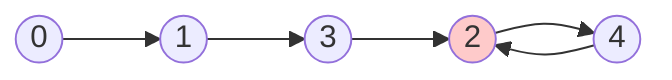

<!-- approaches: Sort · Hash set · Binary search on value · Floyd's cycle detection -->
# 287. Find the Duplicate Number

**Medium** · Array · Two Pointers · Binary Search · Bit Manipulation · [LeetCode ↗](https://leetcode.com/problems/find-the-duplicate-number/) · Code: [FindTheDuplicateNumber.java](FindTheDuplicateNumber.java) · Tests: [FindTheDuplicateNumberTest.java](FindTheDuplicateNumberTest.java)

## Đề bài

Mảng `n + 1` số, mỗi số trong `[1, n]`; đúng **một giá trị** bị lặp (có thể lặp nhiều lần). Tìm nó **không sửa mảng**, bộ nhớ `O(1)`.

```
[1,3,4,2,2] -> 2      [3,3,3,3,3] -> 3
```

## Ý tưởng

> Coi mảng là một **danh sách liên kết ngầm**: chỉ số `i` trỏ tới `nums[i]`. Vì giá trị lặp có **hai chỉ số cùng trỏ vào**, danh sách có **chu trình** và **điểm vào chu trình** chính là giá trị lặp.
> → Đây là bài 142 Linked List Cycle II trên mảng.

`nums = [1, 3, 4, 2, 2]`:



Chỉ số 3 và 4 đều trỏ tới 2 → điểm vào chu trình là **2**.

## Cách 1 — Sắp xếp bản sao `O(n log n) · O(n)`

## Cách 2 — HashSet `O(n) · O(n)`

## Cách 3 — Nhị phân trên giá trị `O(n log n) · O(1)`

Đếm số phần tử `≤ mid`. Nếu không có giá trị lặp trong `[1, mid]` thì có tối đa `mid` số như vậy. Đếm được **nhiều hơn** `mid` → giá trị lặp nằm trong `[1, mid]` (nguyên lý **chuồng bồ câu**).

## Cách 4 — Floyd `O(n) · O(1)` ⭐

1. Rùa đi 1 bước (`nums[slow]`), thỏ đi 2 bước, tới khi gặp nhau trong chu trình.
2. Đưa rùa về đầu; cả hai cùng đi 1 bước; chỗ gặp lại là điểm vào chu trình.

**Vì sao bước 2 đúng?** Gọi `a` = khoảng cách từ đầu tới điểm vào, `c` = độ dài chu trình. Lúc gặp, thỏ đi gấp đôi rùa nên quãng rùa đã đi là bội số của `c`; từ điểm gặp đi thêm `a` bước sẽ về đúng điểm vào — bằng đúng quãng từ đầu tới điểm vào.

## Bài liên quan

142 Linked List Cycle II · 268 Missing Number · 442 Find All Duplicates in an Array · 41 First Missing Positive.
