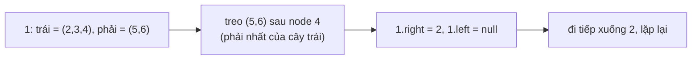

<!-- approaches: Preorder into a list · Reverse postorder with prev · Morris-style in place -->
# 114. Flatten Binary Tree to Linked List

**Medium** · Linked List · Stack · Tree · Depth-First Search · [LeetCode ↗](https://leetcode.com/problems/flatten-binary-tree-to-linked-list/) · Code: [FlattenBinaryTreeToLinkedList.java](FlattenBinaryTreeToLinkedList.java) · Tests: [FlattenBinaryTreeToLinkedListTest.java](FlattenBinaryTreeToLinkedListTest.java)

## Đề bài

"Duỗi" cây nhị phân thành một **danh sách liên kết** tại chỗ: con trỏ `right` đóng vai `next`, mọi `left` là `null`, thứ tự node theo **preorder**. Follow-up: `O(1)` bộ nhớ.

```
      1
     / \
    2   5        ->   1 → 2 → 3 → 4 → 5 → 6
   / \   \
  3   4   6
```

## Ý tưởng

> Trong preorder, ngay **sau toàn bộ cây con trái** là cây con phải. Node cuối cùng của cây con trái (theo preorder) là node **phải nhất** của nó.
> → Treo cây con phải vào sau node đó, chuyển cây con trái sang phải, rồi đi tiếp.



## Cách 1 — Preorder ra danh sách rồi nối lại `O(n)` bộ nhớ

## Cách 2 — Preorder ngược + `prev`

Duyệt theo thứ tự **phải → trái → gốc** (ngược preorder). Mỗi node được nối vào **đầu** danh sách đã dựng (`node.right = prev`). Gọn, nhưng stack đệ quy `O(h)`.

## Cách 3 — Tại chỗ kiểu Morris `O(1)` ⭐

Một vòng lặp đi theo `right`:

| curr | có trái? | việc làm |
|---|---|---|
| 1 | có (2) | phải nhất của cây trái = 4 → `4.right = 5`; `1.right = 2` |
| 2 | có (3) | phải nhất = 3 → `3.right = 4`; `2.right = 3` |
| 3, 4, 5 | không | đi tiếp |
| 5 | không trái | đi tiếp tới 6 |

Mỗi cạnh được duyệt tối đa hai lần → `O(n)` thời gian.

## Bài liên quan

114 là anh em của 430 Flatten a Multilevel Doubly Linked List · 94/144 traversal · 897 Increasing Order Search Tree.
