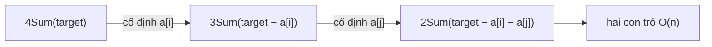

<!-- approaches: Brute force · Sort + 2 loops + two pointers · Generic k-Sum -->
# 18. 4Sum

**Medium** · Array · Two Pointers · Sorting · [LeetCode ↗](https://leetcode.com/problems/4sum/) · Code: [FourSum.java](FourSum.java) · Tests: [FourSumTest.java](FourSumTest.java)

## Đề bài

Tìm mọi bộ bốn **không trùng** có tổng bằng `target`.

```
[1,0,-1,0,-2,2], target = 0 -> [[-2,-1,1,2], [-2,0,0,2], [-1,0,0,1]]
```

## Ý tưởng

> **3Sum thêm một vòng lặp.** Tổng quát: k-Sum = cố định một số rồi giải (k−1)-Sum, cho tới khi còn 2-Sum bằng hai con trỏ.



## Cách 1 — Vét cạn `O(n⁴)`

## Cách 2 — Hai vòng + hai con trỏ `O(n³)` ⭐

Giống 3Sum, thêm vòng `j`. Khử trùng ở **cả bốn vị trí**: `i`, `j` (chú ý điều kiện `j > i + 1`), `lo`, `hi`.

## Cách 3 — k-Sum đệ quy

Một hàm cho mọi `k`. Nếu người phỏng vấn hỏi "còn 5Sum, 6Sum?" thì đây là câu trả lời.

## Bẫy & lưu ý

- **Tràn số**: giá trị tới `10⁹`, bốn số cộng lại vượt `int` → tính tổng bằng `long`. Test có ca `4 × 10⁹` để bắt lỗi này.
- Khử trùng `j` phải so `j > i + 1`, không phải `j > 0` — nếu không sẽ bỏ sót `[2,2,2,2]`.

## Bài liên quan

15 3Sum · 16 3Sum Closest · 454 4Sum II (bốn mảng, dùng HashMap `O(n²)`).
