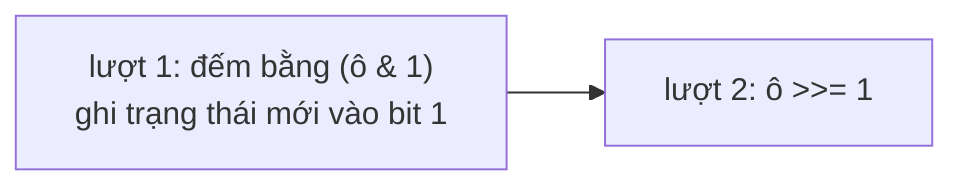

<!-- approaches: Copy of the board · In place with two-bit states -->
# 289. Game of Life

**Medium** · Array · Matrix · Simulation · [LeetCode ↗](https://leetcode.com/problems/game-of-life/) · Code: [GameOfLife.java](GameOfLife.java) · Tests: [GameOfLifeTest.java](GameOfLifeTest.java)

## Đề bài

**Trò chơi cuộc sống** của Conway. Mọi ô cập nhật **đồng thời**:

| hiện tại | số hàng xóm sống (8 hướng) | kế tiếp |
|---|---|---|
| sống | 2 hoặc 3 | sống |
| sống | < 2 hoặc > 3 | chết |
| chết | đúng 3 | sống |

Cập nhật bảng **tại chỗ**.

## Ý tưởng

> Khó khăn duy nhất: cập nhật đồng thời. Ghi trạng thái mới vào ô `(i, j)` sẽ làm sai việc đếm hàng xóm cho các ô sau.
> Mẹo: mỗi ô là một số nguyên, chỉ dùng bit 0. Lưu **trạng thái mới vào bit 1**, giữ nguyên bit 0 cho đến khi tính xong cả bảng.

| giá trị | bit 1 (mới) | bit 0 (cũ) | nghĩa |
|---|---|---|---|
| 0 | 0 | 0 | chết → chết |
| 1 | 0 | 1 | sống → chết |
| 2 | 1 | 0 | chết → sống |
| 3 | 1 | 1 | sống → sống |

## Cách 1 — Bản sao `O(m·n)` bộ nhớ

Đọc từ bản sao, ghi vào bảng.

## Cách 2 — Hai bit trong một ô `O(1)` bộ nhớ ⭐

Khi đếm hàng xóm luôn dùng `cell & 1` để đọc trạng thái **cũ**, kể cả với ô đã được xử lý.

## Câu hỏi mở rộng

- Bảng **vô hạn**? → chỉ lưu tập toạ độ các ô sống (HashSet), mỗi thế hệ đếm hàng xóm bằng HashMap.
- Bảng rất lớn, phần lớn chết? → cũng dùng tập ô sống — chỉ các ô sống và láng giềng của chúng mới có thể thay đổi.

## Bài liên quan

73 Set Matrix Zeroes (cùng mẹo lưu thông tin tạm trong chính ma trận) · 48 Rotate Image.
