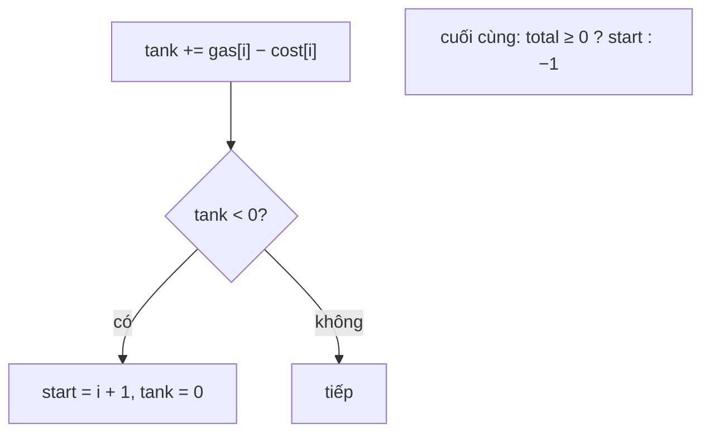

<!-- approaches: One-pass greedy with a running tank · Brute force check -->
# 134. Gas Station

**Medium** · Array · Greedy · [LeetCode ↗](https://leetcode.com/problems/gas-station/) · Code: [GasStation.java](GasStation.java) · Tests: [GasStationTest.java](GasStationTest.java)

## Đề bài

`n` trạm xăng trên vòng tròn. Trạm `i` có `gas[i]` lít, đi tới trạm kế tốn `cost[i]` lít. Bắt đầu với bình rỗng, xuất phát từ trạm nào thì đi hết một vòng? Không được thì `−1`.

```
gas  = [1,2,3,4,5]
cost = [3,4,5,1,2]   -> 3
```

## Ý tưởng — hai nhận xét

> 1. **Tổng xăng ≥ tổng chi phí** ⇔ có lời giải.
> 2. Xuất phát từ `start`, nếu bình **âm** ngay sau trạm `i` thì **không trạm nào** trong `[start, i]` làm điểm xuất phát được. (Đến mỗi trạm giữa đường ta luôn có bình ≥ 0; bắt đầu ở đó với bình 0 chỉ tệ hơn.) → nhảy thẳng `start = i + 1`.

| i | gas − cost | bình | start |
|---|---|---|---|
| 0 | −2 | âm → 0 | 1 |
| 1 | −2 | âm → 0 | 2 |
| 2 | −2 | âm → 0 | 3 |
| 3 | +3 | 3 | 3 |
| 4 | +3 | 6 | 3 |

Tổng = 0 ≥ 0 → đáp án **3**.



## Cách 1 — Tham lam một lượt `O(n)` ⭐

## Cách 2 — Thử mọi điểm xuất phát `O(n²)` (dùng để đối chiếu trong test)

## Bài liên quan

53 Maximum Subarray (cùng kiểu "reset khi âm") · 871 Minimum Number of Refueling Stops (Hard).
