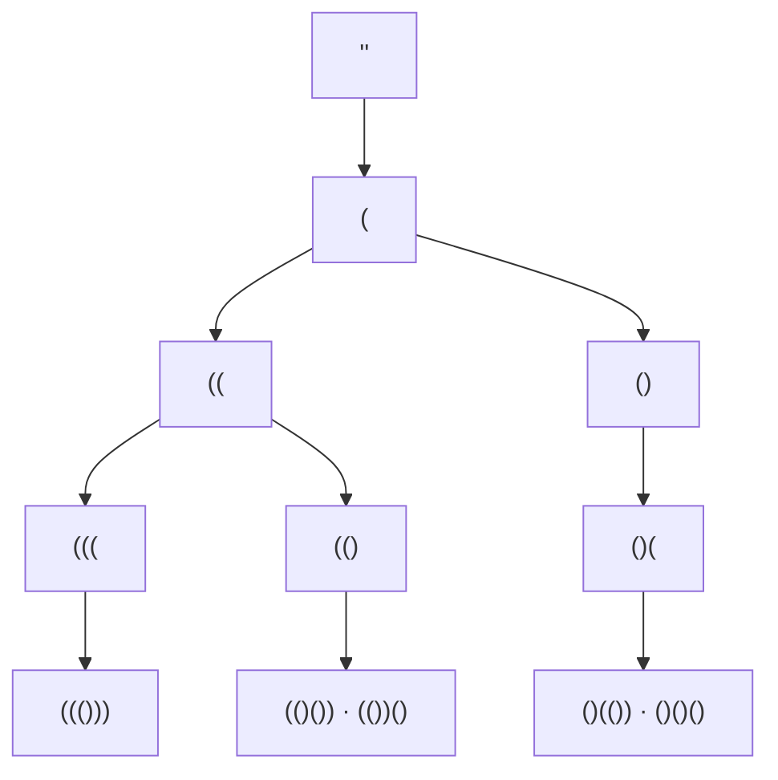

<!-- approaches: Brute force + validate · Backtracking with open/close counts · DP by first pair -->
# 22. Generate Parentheses

**Medium** · String · Dynamic Programming · Backtracking · Bracket Sequences · [LeetCode ↗](https://leetcode.com/problems/generate-parentheses/) · Code: [GenerateParentheses.java](GenerateParentheses.java) · Tests: [GenerateParenthesesTest.java](GenerateParenthesesTest.java)

## Đề bài

Sinh mọi chuỗi **ngoặc hợp lệ** gồm `n` cặp ngoặc.

```
n = 3 -> ((()))  (()())  (())()  ()(())  ()()()
```

## Ý tưởng

> Chỉ xây những **tiền tố hợp lệ**, cắt bỏ nhánh hỏng ngay từ đầu. Một tiền tố hợp lệ khi:
> - số `(` đã dùng `≤ n`;
> - số `)` **không vượt** số `(` (nếu không sẽ có `)` không có cặp).



## Cách 1 — Vét cạn + kiểm tra `O(2²ⁿ · n)`

Sinh mọi chuỗi `(`/`)` dài `2n` rồi lọc. Dùng làm chuẩn để test.

## Cách 2 — Backtracking với số ngoặc mở/đóng ⭐

| điều kiện | được thêm |
|---|---|
| `open < n` | `(` |
| `close < open` | `)` |

Mọi lá của cây đều là đáp án hợp lệ — không có nhánh nào bị bỏ phí.

## Cách 3 — DP theo cặp ngoặc đầu tiên

Mọi chuỗi hợp lệ có dạng **`(A)B`**: `A` là phần bên trong cặp ngoặc mở đầu (`k` cặp), `B` là phần còn lại (`n−1−k` cặp). Ghép từ kết quả các `n` nhỏ hơn.

## Độ phức tạp

Số kết quả là **số Catalan** `Cₙ = C(2n, n) / (n + 1)` ≈ `4ⁿ / (n^1.5 √π)`: 1, 1, 2, 5, 14, 42, 132…

## Bài liên quan

20 Valid Parentheses · 17 Letter Combinations · 32 Longest Valid Parentheses · 96 Unique Binary Search Trees (cũng là số Catalan).
