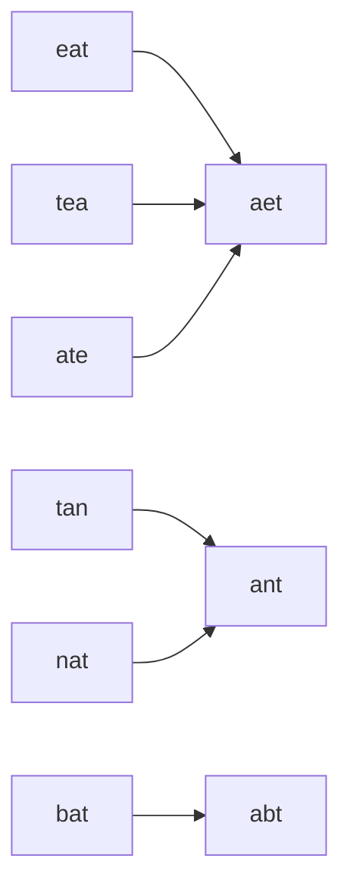

<!-- approaches: Sorted-letters key · Letter-count key -->
# 49. Group Anagrams

**Medium** · Array · Hash Table · String · Sorting · [LeetCode ↗](https://leetcode.com/problems/group-anagrams/) · Code: [GroupAnagrams.java](GroupAnagrams.java) · Tests: [GroupAnagramsTest.java](GroupAnagramsTest.java)

## Đề bài

Gom các từ là **đảo chữ** (anagram — cùng bộ chữ cái) của nhau vào cùng một nhóm.

```
["eat","tea","tan","ate","nat","bat"] -> [["eat","tea","ate"], ["tan","nat"], ["bat"]]
```

## Ý tưởng

> Tìm một **"chữ ký"** giống nhau cho mọi từ trong cùng nhóm và khác nhau giữa các nhóm, rồi dùng nó làm khoá của HashMap.



## Cách 1 — Khoá là chữ cái đã sắp xếp `O(n·k log k)` ⭐

`"tea" → "aet"`. Ngắn, dễ giải thích, đủ nhanh (từ dài tối đa 100).

## Cách 2 — Khoá là bảng đếm chữ cái `O(n·k)`

`"eat"` → đếm 26 chữ → `"#1#0#0#0#1#0…#1…"`. Không sắp xếp nên tuyến tính theo độ dài từ; thắng khi từ rất dài.

| từ | a | e | t | khoá |
|---|---|---|---|---|
| eat | 1 | 1 | 1 | #1…#1…#1 |
| tea | 1 | 1 | 1 | giống trên |

## Bẫy & lưu ý

- Cách 2 phải có **dấu phân cách** giữa các số đếm: không có thì đếm `[1, 11]` và `[11, 1]` đều thành `"111"`.
- `computeIfAbsent(key, k -> new ArrayList<>()).add(s)` gọn hơn kiểm tra `containsKey`.
- Chuỗi rỗng `""` cũng là một nhóm.

## Bài liên quan

242 Valid Anagram · 438 Find All Anagrams in a String · 249 Group Shifted Strings.
