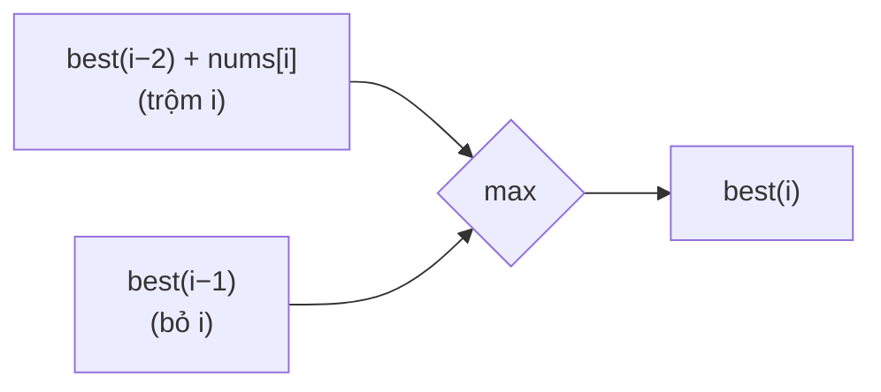

<!-- approaches: Memoized recursion · DP array · Two variables -->
# 198. House Robber

**Medium** · Array · Dynamic Programming · [LeetCode ↗](https://leetcode.com/problems/house-robber/) · Code: [HouseRobber.java](HouseRobber.java) · Tests: [HouseRobberTest.java](HouseRobberTest.java)

## Đề bài

Các nhà trên một con phố có `nums[i]` tiền; trộm **hai nhà liền kề** sẽ bị báo động. Trộm được nhiều nhất bao nhiêu?

```
[2,7,9,3,1] -> 12   (2 + 9 + 1)
```

## Ý tưởng

> Tới nhà `i`, chỉ có hai lựa chọn:
> - **Trộm** nhà `i` → không được trộm nhà `i−1` → `nums[i] + best(i−2)`.
> - **Bỏ qua** → `best(i−1)`.



| i | 0 | 1 | 2 | 3 | 4 |
|---|---|---|---|---|---|
| nums | 2 | 7 | 9 | 3 | 1 |
| best | 2 | 7 | 11 | 11 | **12** |

## Cách 1 — Đệ quy có nhớ

## Cách 2 — Mảng DP

`dp[i]` = tốt nhất với `i` nhà đầu, `dp[0] = 0`, `dp[1] = nums[0]`.

## Cách 3 — Hai biến `O(1)` ⭐

Cấu trúc y hệt 70 Climbing Stairs, chỉ thay `+` bằng `max`.

## Bài liên quan

213 House Robber II (nhà xếp vòng: giải hai lần, bỏ nhà đầu hoặc nhà cuối) · 337 House Robber III (cây) · 740 Delete and Earn · 70 Climbing Stairs.
