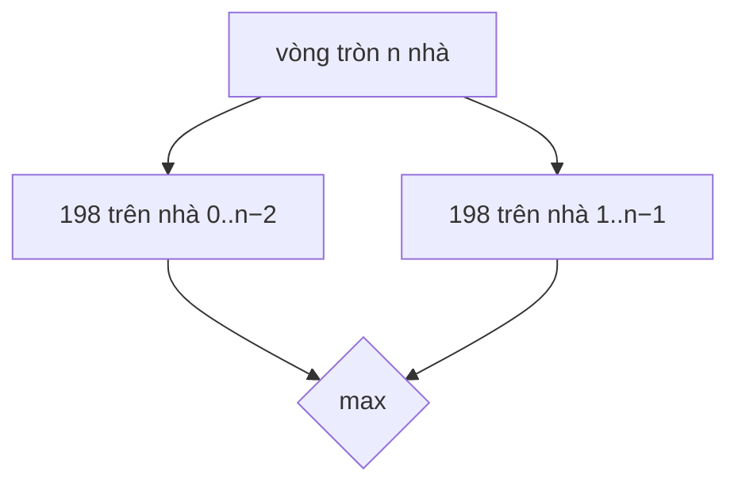

<!-- approaches: Two linear runs of House Robber (skip first / skip last) -->
# 213. House Robber II

**Medium** · Array · Dynamic Programming · [LeetCode ↗](https://leetcode.com/problems/house-robber-ii/) · Code: [HouseRobberII.java](HouseRobberII.java) · Tests: [HouseRobberIITest.java](HouseRobberIITest.java)

## Đề bài

Như bài 198 House Robber, nhưng các nhà xếp thành **vòng tròn**: nhà đầu và nhà cuối là hàng xóm.

```
[2,3,2] -> 3     (không lấy được cả 2 và 2)
[1,2,3,1] -> 4
```

## Ý tưởng

> Nhà đầu và nhà cuối **không thể cùng bị lấy**. Vậy lời giải tối ưu thuộc một trong hai trường hợp:
> - **bỏ nhà cuối** → bài 198 trên `[0 .. n−2]`;
> - **bỏ nhà đầu** → bài 198 trên `[1 .. n−1]`.
> Lấy max của hai.



Bài 198: `best[i] = max(best[i−1], best[i−2] + nums[i])` — bỏ nhà `i`, hoặc lấy nó cộng kết quả cách hai nhà.

## Lời giải `O(n) · O(1)` ⭐

**Bẫy:** `n = 1` — hai đoạn đều rỗng, phải trả về `nums[0]` riêng.

## Bài liên quan

198 House Robber · 337 House Robber III (trên cây) · 740 Delete and Earn · 2560 House Robber IV.
