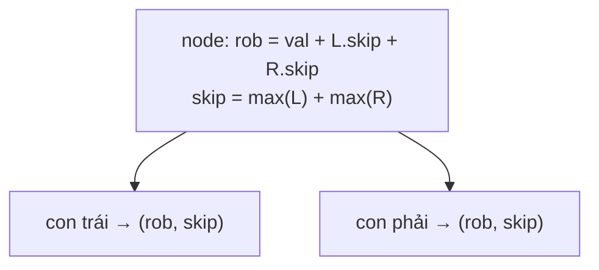

<!-- approaches: Recursion with memo on nodes · Postorder returning (rob, skip) -->
# 337. House Robber III

**Medium** · Dynamic Programming · Tree · Depth-First Search · Binary Tree · [LeetCode ↗](https://leetcode.com/problems/house-robber-iii/) · Code: [HouseRobberIII.java](HouseRobberIII.java) · Tests: [HouseRobberIIITest.java](HouseRobberIIITest.java)

## Đề bài

Các ngôi nhà xếp thành **cây nhị phân**; trộm hai nhà nối trực tiếp (cha–con) sẽ bị báo động. Trộm được nhiều nhất bao nhiêu?

```
     3
    / \
   2   3        -> 7  (3 + 3 + 1)
    \   \
     3   1
```

## Ý tưởng

> Mỗi node chỉ cần trả lời **hai câu hỏi** cho cha của nó:
> - `rob` = tốt nhất **nếu trộm** node này (khi đó hai con **không** được trộm);
> - `skip` = tốt nhất **nếu bỏ** node này (hai con tự do chọn).



Cây ví dụ:

| node | rob | skip |
|---|---|---|
| lá 3 | 3 | 0 |
| lá 1 | 1 | 0 |
| 2 (con: 3) | 2 + 0 = 2 | 3 |
| 3 (con: 1) | 3 + 0 = 3 | 1 |
| gốc 3 | 3 + 3 + 1 = **7** | 3 + 3 = 6 |

## Cách 1 — Đệ quy có nhớ theo node

`max(trộm node + tốt nhất của 4 cháu, tốt nhất của 2 con)`. Cần memo vì cháu được tính lại từ nhiều nơi.

## Cách 2 — Trả về cặp (rob, skip) `O(n)` ⭐

Mỗi node được thăm đúng một lần, không cần HashMap. Đây là **DP trên cây**: trạng thái DP gắn với node, tính bằng postorder.

## Bài liên quan

198 House Robber · 213 House Robber II · 968 Binary Tree Cameras (Hard, DP trên cây ba trạng thái) · 124 Binary Tree Maximum Path Sum.
