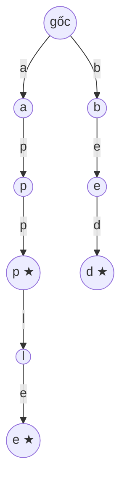

<!-- approaches: Array of 26 children · Hash map children -->
# 208. Implement Trie (Prefix Tree)

**Medium** · Hash Table · String · Design · Trie · [LeetCode ↗](https://leetcode.com/problems/implement-trie-prefix-tree/) · Code: [ImplementTriePrefixTree.java](ImplementTriePrefixTree.java) · Tests: [ImplementTriePrefixTreeTest.java](ImplementTriePrefixTreeTest.java)

## Đề bài

Cài đặt **Trie** (cây tiền tố) với `insert(word)`, `search(word)` (có **đúng** từ này không) và `startsWith(prefix)` (có từ nào bắt đầu bằng tiền tố này không).

## Ý tưởng

> Mỗi **cạnh** là một chữ cái; mỗi đường đi từ gốc là một **tiền tố**. Các từ chung tiền tố **dùng chung** đoạn đường đầu.
> Mỗi node có cờ `end` đánh dấu "một từ kết thúc ở đây" — để phân biệt `app` (một từ) với `app` (chỉ là tiền tố của `apple`).

★ = `end = true`. Trie trên chứa `app`, `apple`, `bed`.

| thao tác | việc làm | kết quả cuối |
|---|---|---|
| `search("app")` | đi a → p → p | node tồn tại **và** `end` |
| `startsWith("ap")` | đi a → p | chỉ cần node tồn tại |
| `search("ap")` | đi a → p | node tồn tại nhưng `end = false` → false |

Mọi thao tác `O(L)` với `L` là độ dài từ — **không phụ thuộc** số từ đã lưu.

## Cách 1 — Mảng 26 con ⭐

Nhanh nhất (tra mảng), nhưng mỗi node tốn 26 ô dù chỉ dùng 1–2.

## Cách 2 — HashMap con

Chỉ tốn bộ nhớ cho cạnh thật sự tồn tại; dùng được cho Unicode. Chậm hơn chút.

## Ứng dụng

Gợi ý từ khi gõ (autocomplete), kiểm tra chính tả, định tuyến IP (longest prefix match), tìm nhiều từ trong lưới (212 Word Search II).

## Bài liên quan

211 Design Add and Search Words · 212 Word Search II (Hard) · 1268 Search Suggestions System · 14 Longest Common Prefix.
