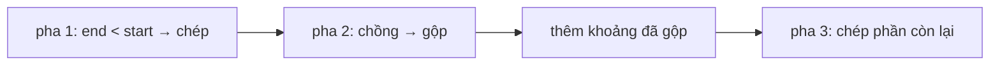

<!-- approaches: Three phases: before, merge overlapping, after -->
# 57. Insert Interval

**Medium** · Array · [LeetCode ↗](https://leetcode.com/problems/insert-interval/) · Code: [InsertInterval.java](InsertInterval.java) · Tests: [InsertIntervalTest.java](InsertIntervalTest.java)

## Đề bài

Các khoảng đã **sắp xếp và không chồng nhau**. Chèn `newInterval`, gộp nếu chồng, giữ thứ tự.

```
[[1,2],[3,5],[6,7],[8,10],[12,16]] + [4,8] -> [[1,2],[3,10],[12,16]]
```

## Ý tưởng — ba pha

> 1. Khoảng **kết thúc trước** khi khoảng mới bắt đầu (`end < start`) → chép nguyên.
> 2. Khoảng **chồng** với khoảng mới (`start ≤ end_mới`) → gộp vào: lấy min đầu, max cuối.
> 3. Phần còn lại → chép nguyên.

```
1-2  3-5  6-7  8-10  12-16
     [ 4 ─────── 8 ]
pha1 | pha 2 gộp → 3-10 | pha 3
```



## Lời giải `O(n)` ⭐

Không cần sắp xếp lại như bài 56 — đầu vào đã sắp xếp nên chỉ một lượt. Hai khoảng **chạm nhau** (`[1,3]` và `[3,5]`) cũng gộp.

## Bài liên quan

56 Merge Intervals · 715 Range Module · 352 Data Stream as Disjoint Intervals · 435 Non-overlapping Intervals.
