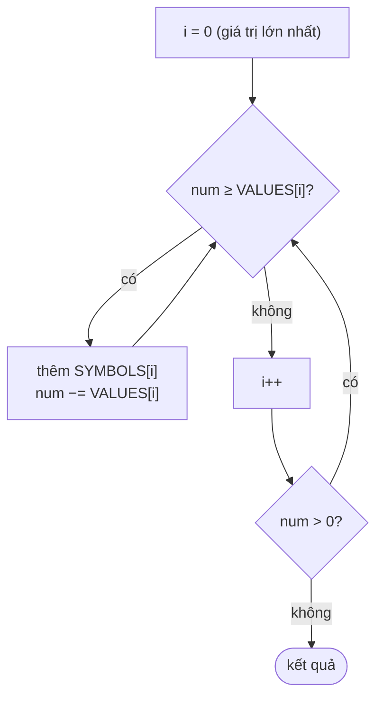

<!-- approaches: Greedy value table · Per-digit tables -->
# 12. Integer to Roman

**Medium** · Hash Table · Math · String · [LeetCode ↗](https://leetcode.com/problems/integer-to-roman/) · Code: [IntegerToRoman.java](IntegerToRoman.java) · Tests: [IntegerToRomanTest.java](IntegerToRomanTest.java)

## Đề bài

Đổi số `1..3999` sang số La Mã.

```
1994 -> "MCMXCIV"  (M + CM + XC + IV)      58 -> "LVIII"  (L + V + III)
```

## Ý tưởng

> Coi 6 dạng trừ (`CM`, `CD`, `XC`, `XL`, `IX`, `IV`) là **ký hiệu riêng**. Khi đó có 13 "đồng xu"
> `1000, 900, 500, 400, 100, 90, 50, 40, 10, 9, 5, 4, 1` và bài toán thành **đổi tiền tham lam**: luôn lấy đồng lớn nhất còn vừa.

## Cách 1 — Tham lam theo bảng giá trị ⭐



| num | đồng lấy | kết quả |
|---|---|---|
| 1994 | 1000 M | M |
| 994 | 900 CM | MCM |
| 94 | 90 XC | MCMXC |
| 4 | 4 IV | MCMXCIV |

Tham lam đúng ở đây vì hệ La Mã được thiết kế "chuẩn" (mỗi số chỉ có một cách viết hợp lệ).

## Cách 2 — Bảng theo từng chữ số

Mỗi chữ số thập phân (nghìn, trăm, chục, đơn vị) có đúng 10 cách viết → tra 4 bảng rồi nối. Không vòng lặp, rất dễ kiểm chứng.

## Bẫy & lưu ý

- Bảng giá trị phải sắp **giảm dần** và có đủ 6 dạng trừ; thiếu `900` sẽ ra `DCCCC`.
- Độ dài kết quả bị chặn (tối đa 15 ký tự) nên độ phức tạp là `O(1)`.

## Bài liên quan

13 Roman to Integer · 273 Integer to English Words (Hard, cùng ý tưởng chia theo nhóm chữ số).
