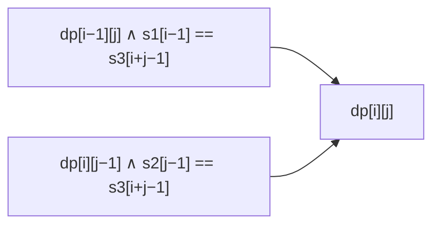

<!-- approaches: 2D DP over prefixes · 1D rolling row -->
# 97. Interleaving String

**Medium** · String · Dynamic Programming · [LeetCode ↗](https://leetcode.com/problems/interleaving-string/) · Code: [InterleavingString.java](InterleavingString.java) · Tests: [InterleavingStringTest.java](InterleavingStringTest.java)

## Đề bài

`s3` có phải là **đan xen** của `s1` và `s2` không — trộn hai chuỗi nhưng giữ nguyên thứ tự ký tự trong từng chuỗi?

```
s1 = aabcc, s2 = dbbca, s3 = aadbbcbcac -> true
     aa  bc  c
       dbb  b ca      (chữ in thường của s1, gạch dưới của s2)
```

## Ý tưởng

> Hai con trỏ tham lam bị kẹt khi cả `s1` và `s2` cùng khớp ký tự kế tiếp — không biết lấy bên nào. DP thử cả hai.
> `dp[i][j]` = `i` ký tự đầu của `s1` và `j` ký tự đầu của `s2` đan xen được thành `s3[0 .. i+j)`. Ký tự cuối `s3[i+j−1]` đến từ `s1` (`dp[i−1][j]` và khớp `s1[i−1]`) **hoặc** từ `s2`.



Có thể hình dung như **đi trên lưới** `(m+1) × (n+1)`: đi xuống = lấy ký tự `s1`, đi sang phải = lấy ký tự `s2`; hỏi có đường từ `(0,0)` tới `(m,n)` không.

## Cách 1 — DP 2 chiều `O(m·n)` ⭐

Kiểm tra độ dài trước: `|s1| + |s2| ≠ |s3|` → `false`.

## Cách 2 — Một hàng `O(n)` bộ nhớ (follow-up)

## Bài liên quan

72 Edit Distance · 1143 Longest Common Subsequence · 115 Distinct Subsequences · 62 Unique Paths.
