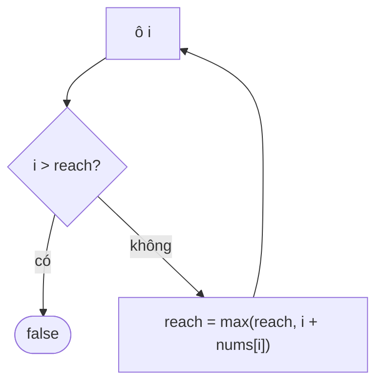

<!-- approaches: Greedy farthest reach · Backward goal -->
# 55. Jump Game

**Medium** · Array · Dynamic Programming · Greedy · [LeetCode ↗](https://leetcode.com/problems/jump-game/) · Code: [JumpGame.java](JumpGame.java) · Tests: [JumpGameTest.java](JumpGameTest.java)

## Đề bài

`nums[i]` = bước nhảy **tối đa** từ ô `i`. Bắt đầu ở ô 0, có tới được ô cuối không?

```
[2,3,1,1,4] -> true      [3,2,1,0,4] -> false (kẹt ở ô 3)
```

## Ý tưởng

> Giữ `reach` = ô **xa nhất** tới được cho tới giờ. Đi qua từng ô: nếu ô hiện tại **vượt quá** `reach` → không bao giờ tới được ô này → `false`.

| i | nums[i] | reach |
|---|---|---|
| 0 | 3 | 3 |
| 1 | 2 | 3 |
| 2 | 1 | 3 |
| 3 | 0 | 3 |
| 4 | | 4 &gt; 3 → **false** |



## Cách 1 — Tham lam theo tầm xa `O(n)` ⭐

## Cách 2 — Lùi đích từ cuối về

Đích ban đầu là ô cuối. Đi ngược: ô nào nhảy tới được đích thì trở thành đích mới. Kết thúc khi đích về 0 → `true`.

## Bài liên quan

45 Jump Game II · 1306 Jump Game III · 1871 Jump Game VII.
