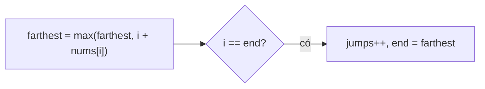

<!-- approaches: Greedy BFS by levels (current reach / farthest) -->
# 45. Jump Game II

**Medium** · Array · Dynamic Programming · Greedy · [LeetCode ↗](https://leetcode.com/problems/jump-game-ii/) · Code: [JumpGameII.java](JumpGameII.java) · Tests: [JumpGameIITest.java](JumpGameIITest.java)

## Đề bài

`nums[i]` = bước nhảy **tối đa** từ ô `i`. Tìm số lần nhảy **ít nhất** để tới ô cuối (luôn tới được).

```
[2,3,1,1,4] -> 2    (0 → 1 → 4)
```

## Ý tưởng — BFS ngầm theo "tầng"

> Các ô tới được bằng `k` lần nhảy tạo thành **một đoạn liên tiếp**. Đi qua đoạn hiện tại, ghi nhận ô **xa nhất** có thể tới bằng một lần nhảy nữa → đó là điểm cuối của đoạn kế tiếp.

```
index: 0  1  2  3  4
nums:  2  3  1  1  4
tầng 0: [0]
tầng 1: [1, 2]        (từ 0 nhảy tối đa 2)
tầng 2: [3, 4]        (từ 1 tới được 4) → chạm ô cuối → 2 lần
```



## Lời giải — Tham lam `O(n) · O(1)` ⭐

Vòng lặp chỉ chạy tới `n − 2`: khi đã đứng ở ô cuối thì không cần nhảy thêm (nếu chạy tới `n − 1` có thể đếm dư một lần).

## Bài liên quan

55 Jump Game · 1306 Jump Game III · 1345 Jump Game IV · 1024 Video Stitching · 1326 Minimum Number of Taps to Open to Water a Garden.
