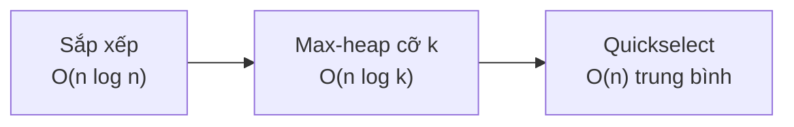

<!-- approaches: Sort · Max-heap of size k · Quickselect -->
# 973. K Closest Points to Origin

**Medium** · Array · Math · Divide and Conquer · Geometry · [LeetCode ↗](https://leetcode.com/problems/k-closest-points-to-origin/) · Code: [KClosestPointsToOrigin.java](KClosestPointsToOrigin.java) · Tests: [KClosestPointsToOriginTest.java](KClosestPointsToOriginTest.java)

## Đề bài

Tìm `k` điểm **gần gốc toạ độ nhất** (thứ tự tuỳ ý).

```
[[3,3],[5,-1],[-2,4]], k = 2 -> [[3,3],[-2,4]]   (khoảng cách² lần lượt 18, 26, 20)
```

## Ý tưởng

> So sánh **bình phương khoảng cách** `x² + y²` — cùng thứ tự với khoảng cách thật, không cần `sqrt` (chậm và có sai số).
> Đây là bài **top-k** kinh điển: ba cách giải tương ứng ba mức đánh đổi.



## Cách 1 — Sắp xếp `O(n log n)`

## Cách 2 — Max-heap kích thước k `O(n log k)` ⭐

Giữ `k` điểm gần nhất trong một **max-heap** (đỉnh = điểm **xa nhất** trong nhóm). Điểm mới gần hơn → đẩy vào, bỏ đỉnh. Hợp khi dữ liệu là **luồng** hoặc `k` nhỏ hơn nhiều so với `n`.

| điểm | dist² | heap (xa nhất ở đầu) |
|---|---|---|
| [3,3] | 18 | 18 |
| [5,−1] | 26 | 26 18 |
| [−2,4] | 20 | 26 20 18 → bỏ 26 → 20 18 |

## Cách 3 — Quickselect `O(n)` trung bình

Phân hoạch như Quicksort quanh một pivot ngẫu nhiên; chỉ đi tiếp vào **một** phía chứa vị trí `k − 1`. Trung bình `n + n/2 + n/4 + … = 2n`. Xấu nhất `O(n²)` (pivot ngẫu nhiên giúp tránh).

## Bẫy & lưu ý

- Comparator viết `dist(a) - dist(b)` có thể tràn với toạ độ lớn → dùng `Integer.compare`.
- Max-heap cho bài "k **nhỏ** nhất", min-heap cho bài "k **lớn** nhất" — ngược với trực giác.

## Bài liên quan

215 Kth Largest Element in an Array · 347 Top K Frequent Elements · 658 Find K Closest Elements · 703 Kth Largest Element in a Stream.
