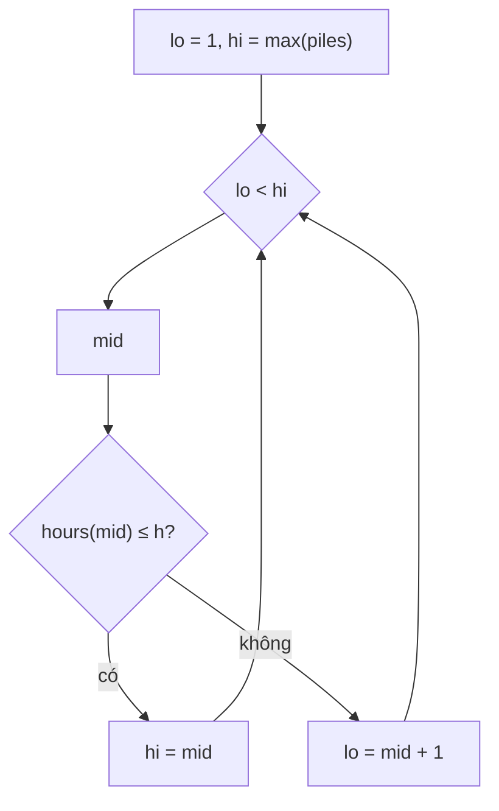

<!-- approaches: Binary search on the answer (eating speed) -->
# 875. Koko Eating Bananas

**Medium** · Array · Binary Search · [LeetCode ↗](https://leetcode.com/problems/koko-eating-bananas/) · Code: [KokoEatingBananas.java](KokoEatingBananas.java) · Tests: [KokoEatingBananasTest.java](KokoEatingBananasTest.java)

## Đề bài

Koko có các đống chuối `piles`. Mỗi giờ chọn một đống, ăn `k` quả (đống ít hơn `k` thì ăn hết đống đó, giờ còn lại bỏ phí). Tìm `k` **nhỏ nhất** để ăn hết trong `h` giờ.

```
piles = [3,6,7,11], h = 8 -> 4      (1 + 2 + 2 + 3 = 8 giờ)
```

## Ý tưởng — tìm kiếm nhị phân trên đáp án

> Số giờ cần với tốc độ `k`: `hours(k) = Σ ⌈p / k⌉` — **giảm dần** khi `k` tăng. Vậy tập các `k` hợp lệ có dạng `[✗ ✗ ✗ ✓ ✓ ✓ …]` → tìm nhị phân `k` đầu tiên thoả `hours(k) ≤ h`, trong khoảng `[1, max(piles)]`.

| k | giờ cần | ≤ 8? |
|---|---|---|
| 1 | 27 | ✗ |
| 3 | 1+2+3+4 = 10 | ✗ |
| **4** | 1+2+2+3 = 8 | ✓ |
| 6 | 1+1+2+2 = 6 | ✓ |



## Lời giải `O(n log max)` ⭐

- `⌈p/k⌉ = (p + k − 1) / k`, tránh số thực.
- Tổng giờ có thể vượt `int` khi `k` nhỏ → dùng `long`.

## Bài liên quan

1011 Capacity To Ship Packages Within D Days · 410 Split Array Largest Sum · 1482 Minimum Number of Days to Make m Bouquets · 774 Minimize Max Distance to Gas Station.
