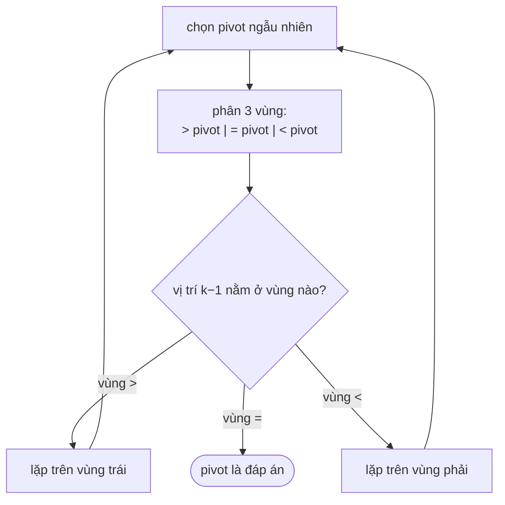

<!-- approaches: Sort · Min-heap of size k · Quickselect · Counting -->
# 215. Kth Largest Element in an Array

**Medium** · Array · Divide and Conquer · Sorting · Heap (Priority Queue) · [LeetCode ↗](https://leetcode.com/problems/kth-largest-element-in-an-array/) · Code: [KthLargestElementInAnArray.java](KthLargestElementInAnArray.java) · Tests: [KthLargestElementInAnArrayTest.java](KthLargestElementInAnArrayTest.java)

## Đề bài

Tìm phần tử **lớn thứ k** (theo thứ tự sắp xếp, tính cả phần tử trùng). Có làm được mà không sắp xếp không?

```
[3,2,1,5,6,4], k = 2 -> 5
[3,2,3,1,2,4,5,5,6], k = 4 -> 4    (sắp giảm: 6 5 5 4 …)
```

## Ý tưởng

> Không cần sắp xếp **toàn bộ** — chỉ cần biết phần tử nào đứng ở vị trí thứ `k`. Quickselect phân hoạch một lần rồi **chỉ đi tiếp một phía**.



## Cách 1 — Sắp xếp `O(n log n)`

## Cách 2 — Min-heap kích thước k `O(n log k)` ⭐ (an toàn, dễ viết)

Như 703: giữ `k` số lớn nhất, đỉnh heap là đáp án.

## Cách 3 — Quickselect phân hoạch 3 vùng `O(n)` trung bình

Phân hoạch **3 vùng** (giống lá cờ Hà Lan, bài 75) thay vì 2: test của LeetCode có mảng rất nhiều phần tử trùng, phân hoạch 2 vùng sẽ suy biến thành `O(n²)`.

`[3,2,1,5,6,4]`, k = 2 (vị trí 1 khi xếp giảm), giả sử pivot = 4:

| vùng > 4 | vùng = 4 | vùng < 4 |
|---|---|---|
| 5 6 (chỉ số 0–1) | 4 (chỉ số 2) | 3 2 1 |

Vị trí 1 nằm trong vùng `> 4` → lặp lại trên `[5, 6]` → được 5.

## Cách 4 — Đếm `O(n + R)`

Giá trị bị chặn trong `[−10⁴, 10⁴]` → mảng đếm, đi từ giá trị lớn xuống tới khi đủ `k`.

## So sánh

| Cách | Thời gian | Bộ nhớ | Ghi chú |
|---|---|---|---|
| Sắp xếp | O(n log n) | O(1)~O(n) | đơn giản |
| Heap | O(n log k) | O(k) | hợp với luồng dữ liệu |
| Quickselect | O(n) TB, O(n²) xấu | O(1) | nhanh nhất trung bình |
| Đếm | O(n + R) | O(R) | chỉ khi giá trị bị chặn nhỏ |

## Bài liên quan

347 Top K Frequent Elements · 973 K Closest Points · 703 Kth Largest in a Stream · 4 Median of Two Sorted Arrays.
