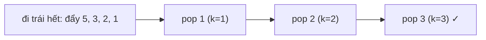

<!-- approaches: Inorder to list · Iterative inorder with early stop · Subtree sizes -->
# 230. Kth Smallest Element in a BST

**Medium** · Tree · Depth-First Search · Binary Search Tree · Binary Tree · [LeetCode ↗](https://leetcode.com/problems/kth-smallest-element-in-a-bst/) · Code: [KthSmallestElementInABST.java](KthSmallestElementInABST.java) · Tests: [KthSmallestElementInABSTTest.java](KthSmallestElementInABSTTest.java)

## Đề bài

Tìm giá trị **nhỏ thứ k** (đếm từ 1) trong BST. Follow-up: cây bị sửa liên tục và truy vấn thường xuyên thì sao?

```
        5
       / \
      3   6
     / \          k = 3 -> 3   (dãy tăng: 1 2 3 4 5 6)
    2   4
   /
  1
```

## Ý tưởng

> **Inorder** BST cho dãy tăng dần → phần tử thứ `k` được thăm chính là đáp án. Dùng inorder **lặp** để **dừng ngay** khi đếm đủ `k`.



## Cách 1 — Inorder ra danh sách `O(n)`

## Cách 2 — Inorder lặp, dừng sớm `O(h + k)` ⭐

Chỉ thăm `k` node đầu tiên (cộng đường đi xuống trái nhất).

## Cách 3 — Follow-up: lưu kích thước cây con

Nếu mỗi node lưu `size` (số node trong cây con), đi xuống như tìm kiếm nhị phân:

| so sánh | đi |
|---|---|
| `k ≤ size(trái)` | sang trái |
| `k == size(trái) + 1` | chính node này |
| ngược lại | sang phải, `k −= size(trái) + 1` |

→ `O(h)` mỗi truy vấn; thêm/xoá node chỉ cần cập nhật `size` trên đường đi (`O(h)`). Đây là ý tưởng **order-statistic tree**. Code minh hoạ tính `size` tại chỗ (chậm) — trong thực tế `size` được lưu trong node.

## Bài liên quan

94 Inorder Traversal · 671 Second Minimum Node · 215 Kth Largest Element in an Array · 173 BST Iterator.
