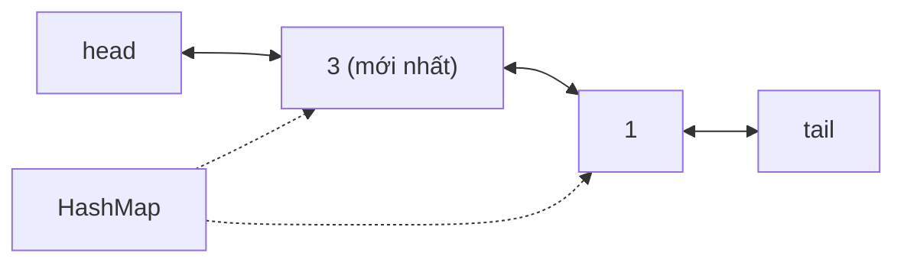

<!-- approaches: HashMap + doubly linked list · LinkedHashMap in access order -->
# 146. LRU Cache

**Medium** · Hash Table · Linked List · Design · Doubly-Linked List · [LeetCode ↗](https://leetcode.com/problems/lru-cache/) · Code: [LRUCache.java](LRUCache.java) · Tests: [LRUCacheTest.java](LRUCacheTest.java)

## Đề bài

Thiết kế cache **LRU** (Least Recently Used) sức chứa `capacity`:
- `get(key)` → giá trị, không có thì `−1`;
- `put(key, value)` → thêm/cập nhật; vượt sức chứa thì **xoá key lâu nhất chưa dùng**.

Cả hai thao tác `O(1)`.

```
cap = 2: put(1) put(2) get(1) put(3)  → 2 bị loại (1 vừa được dùng)
```

## Ý tưởng — HashMap + danh sách liên kết đôi

> - **HashMap** `key → node`: tìm node trong `O(1)`.
> - **Danh sách liên kết đôi** sắp theo độ "mới": đầu = vừa dùng, cuối = lâu nhất. Gỡ một node và chèn lên đầu đều `O(1)` (vì có `prev`).
> Mỗi `get`/`put` chuyển node lên đầu; loại bỏ thì lấy node ngay trước `tail`.



| thao tác | danh sách (mới → cũ) |
|---|---|
| put(1) put(2) | 2, 1 |
| get(1) | 1, 2 |
| put(3) | 3, 1 — loại **2** |
| put(4) | 4, 3 — loại **1** |

## Cách 1 — HashMap + DLL tự viết ⭐ (cách phỏng vấn mong đợi)

Hai node **lính canh** `head`/`tail` giúp không phải kiểm tra `null` khi gỡ/chèn. Node phải lưu cả `key` để khi loại bỏ còn xoá được khỏi HashMap.

## Cách 2 — `LinkedHashMap(accessOrder = true)`

Java có sẵn: mỗi lần truy cập tự chuyển entry xuống cuối; ghi đè `removeEldestEntry` để tự loại bỏ. Biết cách này là điểm cộng, nhưng thường bị yêu cầu tự viết lại cách 1.

## Ứng dụng thực tế

Cache trang của hệ điều hành, buffer pool của database, cache trong Redis (`allkeys-lru`), Guava/Caffeine cache.

## Bài liên quan

460 LFU Cache (Hard) · 432 All O'one Data Structure · 1472 Design Browser History.
