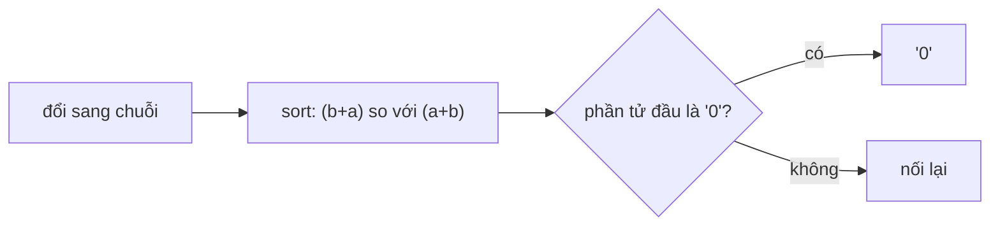

<!-- approaches: Sort by concatenation order (a + b vs b + a) -->
# 179. Largest Number

**Medium** · Array · String · Greedy · Sorting · [LeetCode ↗](https://leetcode.com/problems/largest-number/) · Code: [LargestNumber.java](LargestNumber.java) · Tests: [LargestNumberTest.java](LargestNumberTest.java)

## Đề bài

Xếp các số nguyên không âm cạnh nhau để được **số lớn nhất**.

```
[3,30,34,5,9] -> "9534330"
```

## Ý tưởng

> Không so sánh theo giá trị (`30 > 3` nhưng `3` phải đứng trước `30`), cũng không theo thứ tự từ điển thuần.
> So sánh **cách ghép**: `a` đứng trước `b` ⇔ **`a + b > b + a`**.

| a | b | a + b | b + a | ai trước |
|---|---|---|---|---|
| 3 | 30 | 330 | 303 | **3** |
| 3 | 34 | 334 | 343 | **34** |
| 9 | 5 | 95 | 59 | **9** |



## Lời giải `O(n log n · L)` ⭐

Thứ tự này **bắc cầu** (chứng minh: coi `a + b > b + a` ⇔ `a / (10^|a| − 1) > b / (10^|b| − 1)`), nên dùng để sort là hợp lệ.

**Bẫy:** `[0,0]` → `"0"` chứ không phải `"00"`.

## Bài liên quan

2165 Smallest Value of the Rearranged Number · 670 Maximum Swap · 402 Remove K Digits.
