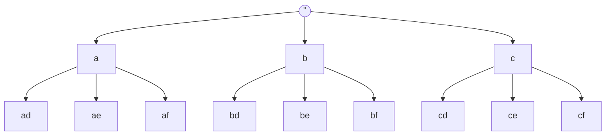

<!-- approaches: Backtracking · BFS queue -->
# 17. Letter Combinations of a Phone Number

**Medium** · Hash Table · String · Backtracking · [LeetCode ↗](https://leetcode.com/problems/letter-combinations-of-a-phone-number/) · Code: [LetterCombinationsOfAPhoneNumber.java](LetterCombinationsOfAPhoneNumber.java) · Tests: [LetterCombinationsOfAPhoneNumberTest.java](LetterCombinationsOfAPhoneNumberTest.java)

## Đề bài

Bàn phím điện thoại cũ: `2 → abc`, `3 → def`, …, `7 → pqrs`, `9 → wxyz`. Liệt kê mọi tổ hợp chữ cái cho chuỗi số.

```
"23" -> ad ae af bd be bf cd ce cf
```

## Ý tưởng

> Mỗi chữ số là một **tầng quyết định**: chọn một chữ cái trong nhóm của nó. Mọi lựa chọn tạo thành một **cây**,
> mỗi lá là một tổ hợp → duyệt cây bằng **backtracking** (DFS) hoặc từng tầng (BFS).



## Cách 1 — Backtracking ⭐

Khuôn mẫu **chọn → đệ quy → bỏ chọn** dùng cho cả họ bài tổ hợp / hoán vị / tập con:

```
backtrack(i):
    if i == n: lưu path; return
    for c in letters(digits[i]):
        path.append(c)       # chọn
        backtrack(i + 1)     # đi sâu
        path.removeLast()    # bỏ chọn
```

Dùng một `StringBuilder` chung, không tạo chuỗi mới ở mỗi bước.

## Cách 2 — BFS từng tầng

Bắt đầu từ `[""]`; mỗi chữ số, nối mọi tiền tố hiện có với từng chữ cái.

| sau chữ số | hàng đợi |
|---|---|
| (đầu) | "" |
| 2 | a b c |
| 3 | ad ae af bd be bf cd ce cf |

## Độ phức tạp

Có tối đa `4ⁿ` tổ hợp, mỗi tổ hợp dài `n` → `O(4ⁿ · n)` — không thể tốt hơn vì phải in ra hết.

## Bẫy & lưu ý

- Chuỗi rỗng → `[]`, **không** phải `[""]`.
- `7` và `9` có **4** chữ cái.

## Bài liên quan

22 Generate Parentheses · 39 Combination Sum · 46 Permutations · 78 Subsets.
