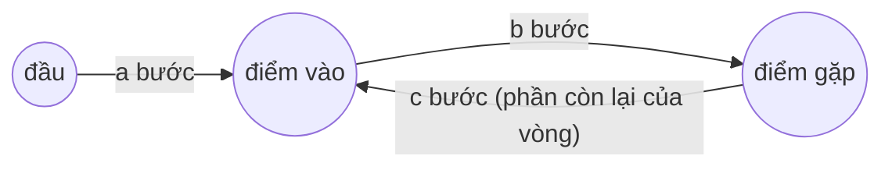

<!-- approaches: Hash set · Floyd: meet, then walk from head -->
# 142. Linked List Cycle II

**Medium** · Hash Table · Linked List · Two Pointers · Floyd's Cycle Finding Algorithm · [LeetCode ↗](https://leetcode.com/problems/linked-list-cycle-ii/) · Code: [LinkedListCycleII.java](LinkedListCycleII.java) · Tests: [LinkedListCycleIITest.java](LinkedListCycleIITest.java)

## Đề bài

Tìm node **bắt đầu chu trình** của danh sách liên kết (không có → `null`). Không sửa danh sách. Follow-up: `O(1)` bộ nhớ.

```
3 → 2 → 0 → −4
    ↑________|        -> node 2
```

## Ý tưởng

> **Floyd hai pha.** Pha 1: rùa/thỏ gặp nhau trong chu trình (bài 141). Pha 2: một con trỏ từ **đầu danh sách**, một con trỏ từ **điểm gặp**, cùng đi 1 bước — chúng gặp nhau đúng tại **điểm vào chu trình**.



**Chứng minh.** Gọi `a` = đầu → điểm vào, `b` = điểm vào → điểm gặp, `L = b + c` = độ dài vòng.
- Rùa đã đi `a + b`; thỏ đi gấp đôi: `2(a + b) = a + b + kL` → `a + b = kL` → `a = kL − b = (k−1)L + c`.
- Vậy đi `a` bước từ **đầu** tới điểm vào, cũng bằng đi `c` bước (cộng vài vòng) từ **điểm gặp** tới điểm vào.

## Cách 1 — HashSet `O(n)` bộ nhớ

Node đầu tiên gặp lại chính là điểm vào chu trình.

## Cách 2 — Floyd hai pha `O(1)` ⭐

## Bài liên quan

141 Linked List Cycle · 287 Find the Duplicate Number (cùng thuật toán trên mảng) · 202 Happy Number · 160 Intersection of Two Linked Lists.
