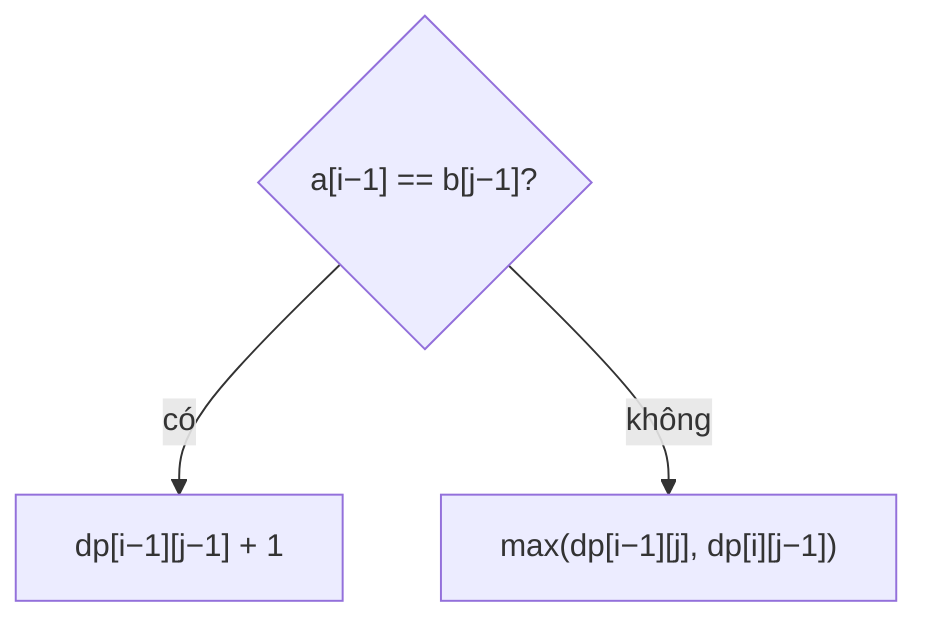

<!-- approaches: Memoized recursion · 2D DP · One rolling row -->
# 1143. Longest Common Subsequence

**Medium** · String · Dynamic Programming · Longest Common Subsequence · [LeetCode ↗](https://leetcode.com/problems/longest-common-subsequence/) · Code: [LongestCommonSubsequence.java](LongestCommonSubsequence.java) · Tests: [LongestCommonSubsequenceTest.java](LongestCommonSubsequenceTest.java)

## Đề bài

Độ dài **dãy con chung** dài nhất của hai chuỗi (giữ thứ tự, không cần liền nhau).

```
("abcde", "ace") -> 3   ("ace")
```

## Ý tưởng

> So **ký tự cuối** của hai tiền tố:
> - **Bằng nhau** → chắc chắn dùng làm phần tử cuối của dãy chung: `dp[i−1][j−1] + 1`.
> - **Khác nhau** → một trong hai ký tự không thuộc dãy chung: `max(dp[i−1][j], dp[i][j−1])`.



Bảng cho `"abcde"` và `"ace"`:

| | "" | a | c | e |
|---|---|---|---|---|
| "" | 0 | 0 | 0 | 0 |
| a | 0 | **1** | 1 | 1 |
| b | 0 | 1 | 1 | 1 |
| c | 0 | 1 | **2** | 2 |
| d | 0 | 1 | 2 | 2 |
| e | 0 | 1 | 2 | **3** |

## Cách 1 — Đệ quy có nhớ

## Cách 2 — Bảng 2D ⭐ (để giải thích, và để **truy vết** ra chính dãy con)

Đi ngược từ `dp[m][n]`: ký tự bằng nhau thì lấy và đi chéo; không thì đi về ô lớn hơn.

## Cách 3 — Một hàng + biến đường chéo `O(min(m, n))`

Khi ghi đè `dp[j]` thì mất giá trị `dp[i−1][j−1]` cho bước sau → lưu nó vào `diagonal` trước.

## Họ bài "hai chuỗi"

LCS là mẹ của nhiều bài: 72 Edit Distance, 583 Delete Operation for Two Strings (`m + n − 2·LCS`), 1092 Shortest Common Supersequence (Hard), 516 Longest Palindromic Subsequence (LCS với chuỗi đảo).

## Bài liên quan

72 Edit Distance · 516 Longest Palindromic Subsequence · 1035 Uncrossed Lines (giống hệt) · 718 Maximum Length of Repeated Subarray.
