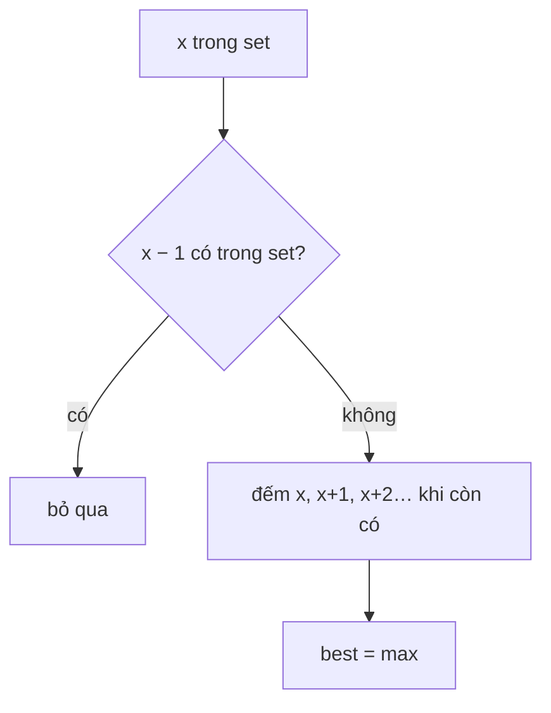

<!-- approaches: HashSet, extend only from sequence starts · Sort -->
# 128. Longest Consecutive Sequence

**Medium** · Array · Hash Table · Union-Find · [LeetCode ↗](https://leetcode.com/problems/longest-consecutive-sequence/) · Code: [LongestConsecutiveSequence.java](LongestConsecutiveSequence.java) · Tests: [LongestConsecutiveSequenceTest.java](LongestConsecutiveSequenceTest.java)

## Đề bài

Mảng chưa sắp xếp. Tìm độ dài dãy **số nguyên liên tiếp** dài nhất. Yêu cầu `O(n)`.

```
[100,4,200,1,3,2] -> 4   (1, 2, 3, 4)
```

## Ý tưởng

> Bỏ hết vào **HashSet**. Chỉ bắt đầu đếm từ `x` khi `x − 1` **không có** trong set — tức `x` là **đầu dãy**. Từ đó đếm `x+1, x+2, …`.
> Mỗi số chỉ được "đi qua" một lần trong vòng `while` (vì chỉ đầu dãy mới mở vòng lặp) → tổng `O(n)`.

```
set = {100, 4, 200, 1, 3, 2}
1   : 0 không có → đầu dãy → 1,2,3,4 → dài 4
2,3,4: có số liền trước → bỏ qua
100 : đầu dãy → dài 1
```



## Cách 1 — HashSet, chỉ đếm từ đầu dãy `O(n)` ⭐

Thiếu kiểm tra `x − 1` thì mỗi số đều mở một vòng đếm → `O(n²)`.

## Cách 2 — Sắp xếp `O(n log n)`

Nhớ bỏ qua số trùng (`[1,2,2,3]` vẫn dài 3).

## Bài liên quan

298 Binary Tree Longest Consecutive Sequence · 1 Two Sum (cùng kiểu tra HashSet).
