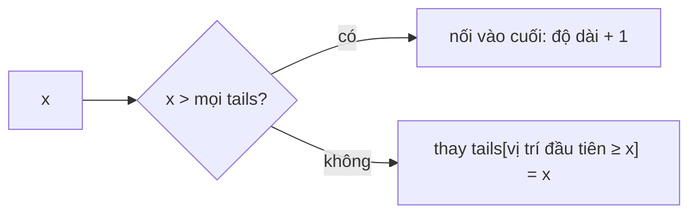

<!-- approaches: DP O(n²) · Patience sorting with binary search · Memoized recursion -->
# 300. Longest Increasing Subsequence

**Medium** · Array · Binary Search · Dynamic Programming · Longest Increasing Subsequence · [LeetCode ↗](https://leetcode.com/problems/longest-increasing-subsequence/) · Code: [LongestIncreasingSubsequence.java](LongestIncreasingSubsequence.java) · Tests: [LongestIncreasingSubsequenceTest.java](LongestIncreasingSubsequenceTest.java)

## Đề bài

Độ dài **dãy con tăng nghiêm ngặt** dài nhất (giữ thứ tự, không cần liền nhau). Follow-up: `O(n log n)`.

```
[10,9,2,5,3,7,101,18] -> 4   (2, 3, 7, 101)
```

## Ý tưởng 1 — DP `O(n²)`

> `dp[i]` = độ dài dãy tăng dài nhất **kết thúc tại** `i` = `1 + max(dp[j])` với mọi `j < i` mà `nums[j] < nums[i]`.

| i | 0 | 1 | 2 | 3 | 4 | 5 | 6 | 7 |
|---|---|---|---|---|---|---|---|---|
| nums | 10 | 9 | 2 | 5 | 3 | 7 | 101 | 18 |
| dp | 1 | 1 | 1 | 2 | 2 | 3 | **4** | **4** |

## Ý tưởng 2 — "Xếp bài kiên nhẫn" `O(n log n)` ⭐

> `tails[k]` = **phần tử cuối nhỏ nhất có thể** của một dãy tăng dài `k + 1`. Cuối càng nhỏ càng dễ nối thêm.
> `tails` luôn **tăng dần** → với mỗi `x`, tìm nhị phân vị trí đầu tiên `≥ x`: thay thế (làm cuối nhỏ hơn) hoặc nối dài (nếu `x` lớn hơn tất cả).



| x | tails |
|---|---|
| 10 | 10 |
| 9 | 9 |
| 2 | 2 |
| 5 | 2 5 |
| 3 | 2 3 |
| 7 | 2 3 7 |
| 101 | 2 3 7 101 |
| 18 | 2 3 7 18 → độ dài **4** |

**Lưu ý:** `tails` **không** phải là dãy con tăng thật (ở đây trùng hợp là đúng) — chỉ **độ dài** của nó là đáp án. Muốn khôi phục dãy cần lưu thêm con trỏ cha.

## Cách 3 — Đệ quy có nhớ (chọn / bỏ qua)

Trạng thái `(vị trí, phần tử chọn trước đó)`. Cách nghĩ tự nhiên nhất khi mới học DP.

## Bẫy & lưu ý

- **Nghiêm ngặt**: dùng "vị trí đầu tiên `≥ x`" (lower bound). Nếu đề cho phép **không giảm** thì dùng "đầu tiên `> x`".

## Bài liên quan

354 Russian Doll Envelopes (Hard) · 673 Number of LIS · 1143 Longest Common Subsequence · 334 Increasing Triplet Subsequence.
