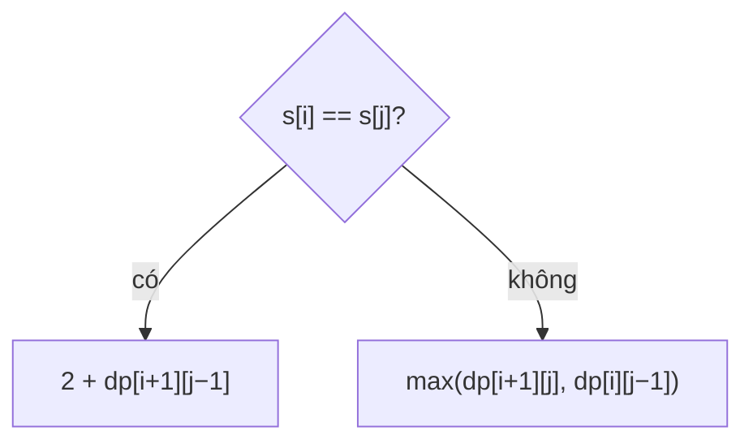

<!-- approaches: Memoized recursion · 2D DP · LCS with the reverse -->
# 516. Longest Palindromic Subsequence

**Medium** · String · Dynamic Programming · [LeetCode ↗](https://leetcode.com/problems/longest-palindromic-subsequence/) · Code: [LongestPalindromicSubsequence.java](LongestPalindromicSubsequence.java) · Tests: [LongestPalindromicSubsequenceTest.java](LongestPalindromicSubsequenceTest.java)

## Đề bài

Độ dài **dãy con** (giữ thứ tự, không cần liền nhau) đối xứng dài nhất.

```
"bbbab" -> 4 ("bbbb")      "cbbd" -> 2 ("bb")
```

## Ý tưởng

> Xét đoạn `s[i..j]`:
> - Hai đầu **bằng nhau** → chắc chắn dùng cả hai làm hai đầu của dãy đối xứng: `2 + lps(i+1, j−1)`.
> - Khác nhau → ít nhất một đầu bị bỏ: `max(lps(i+1, j), lps(i, j−1))`.



Bảng `dp[i][j]` cho `"cbbd"` (chỉ nửa trên):

| i \ j | c | b | b | d |
|---|---|---|---|---|
| c | 1 | 1 | 2 | 2 |
| b | | 1 | 2 | 2 |
| b | | | 1 | 1 |
| d | | | | 1 |

## Cách 1 — Đệ quy có nhớ `O(n²)`

## Cách 2 — DP khoảng từ dưới lên `O(n²)` ⭐

`dp[i][j]` cần `dp[i+1][…]` → duyệt `i` **từ cuối lên**, `j` từ `i + 1` sang phải. Khuôn **DP trên khoảng** (interval DP) — dùng cho 5, 647, 312, 1039.

## Cách 3 — LCS với chuỗi đảo ngược

Dãy con đối xứng của `s` = dãy con **chung** của `s` và `reverse(s)`. Áp dụng 1143 Longest Common Subsequence, chỉ một hàng `O(n)` bộ nhớ.

## Bẫy & lưu ý

- **Dãy con** (subsequence) khác **chuỗi con** (substring, bài 5): ở đây được bỏ ký tự giữa chừng.

## Bài liên quan

5 Longest Palindromic Substring · 1143 Longest Common Subsequence · 1312 Minimum Insertion Steps to Make a String Palindrome (Hard, = n − LPS).
