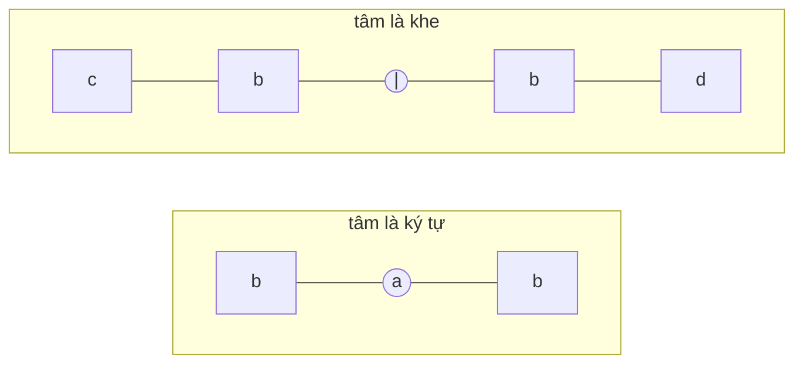
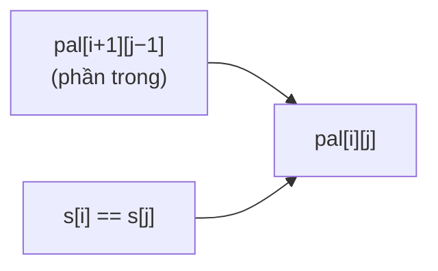

<!-- approaches: Expand around center · DP table · Manacher -->
# 5. Longest Palindromic Substring

**Medium** · Two Pointers · String · Dynamic Programming · [LeetCode ↗](https://leetcode.com/problems/longest-palindromic-substring/) · Code: [LongestPalindromicSubstring.java](LongestPalindromicSubstring.java) · Tests: [LongestPalindromicSubstringTest.java](LongestPalindromicSubstringTest.java)

## Đề bài

Tìm **chuỗi con đối xứng dài nhất**.

```
"babad" -> "bab" (hoặc "aba")      "cbbd" -> "bb"
```

## Ý tưởng

> Mọi chuỗi đối xứng đều **đối xứng quanh một tâm**. Có `2n − 1` tâm: `n` ký tự (độ dài lẻ, `"aba"`) và `n − 1` khe giữa hai ký tự (độ dài chẵn, `"abba"`).
> Từ mỗi tâm, **nở ra hai phía** khi hai đầu còn bằng nhau.



## Cách 1 — Nở từ tâm `O(n²) · O(1)` ⭐

Với mỗi `i`, gọi `expand(i, i)` và `expand(i, i+1)`, lấy độ dài lớn hơn. Từ độ dài `len` và tâm `i` suy ra
`start = i − (len − 1) / 2`, `end = i + len / 2` — đúng cho cả hai loại tâm.

`"babad"`, tâm `i = 1` (`a`):

| left | right | so sánh | |
|---|---|---|---|
| 1 | 1 | a = a | nở |
| 0 | 2 | b = b | nở |
| −1 | 3 | ra ngoài | dừng → độ dài 3 = `"bab"` |

## Cách 2 — Bảng DP `O(n²) · O(n²)`

`pal[i][j] = (s[i] == s[j]) && (j − i < 2 || pal[i+1][j−1])` — chuỗi đối xứng khi hai đầu bằng nhau **và** phần bên trong đối xứng. Điền theo độ dài tăng dần để phần bên trong luôn có sẵn.



Đây là cách nên biết vì cùng khuôn với các bài DP chuỗi khác (516, 647).

## Cách 3 — Manacher `O(n)`

Chèn `#` giữa các ký tự để mọi chuỗi đối xứng đều có độ dài lẻ; nhờ tính đối xứng, bán kính tại `i` **ít nhất** bằng bán kính tại điểm đối xứng `2·center − i` (nếu còn nằm trong chuỗi đối xứng xa nhất). Hiếm khi được yêu cầu viết, nhưng nên biết tên và ý tưởng.

## So sánh

| Cách | Thời gian | Bộ nhớ |
|---|---|---|
| Nở từ tâm | O(n²) | **O(1)** |
| DP | O(n²) | O(n²) |
| Manacher | **O(n)** | O(n) |

## Bẫy & lưu ý

- Quên tâm **chẵn** → `"cbbd"` trả `"c"` thay vì `"bb"`.
- `expand` trả `right − left − 1` vì vòng lặp đã đi lố mỗi bên một bước.

## Bài liên quan

647 Palindromic Substrings (đếm) · 516 Longest Palindromic Subsequence · 131 Palindrome Partitioning · 214 Shortest Palindrome.
